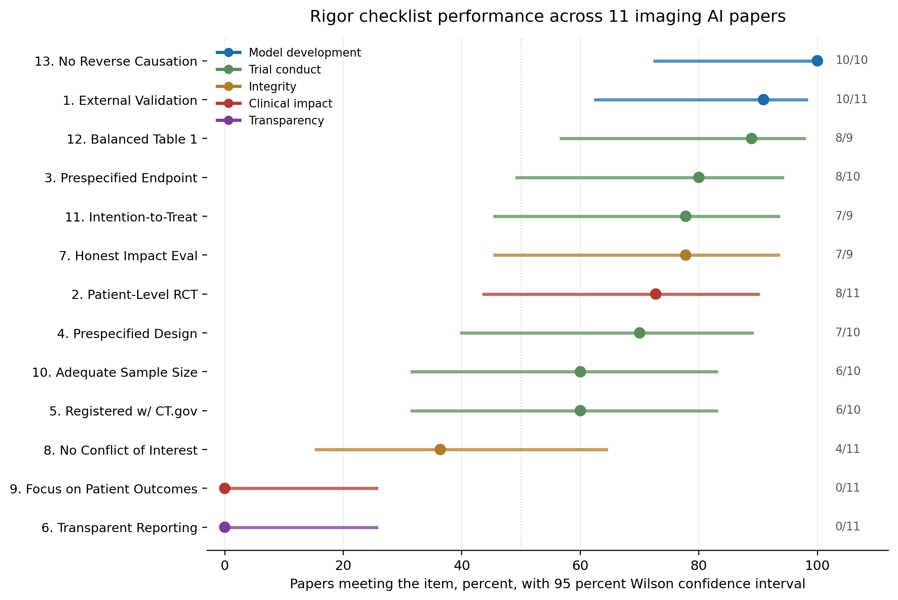

# Hypothesis Assessment

Draft prepared 28 July 2026, interval estimates added 29 July, rescoped to the imaging primary
set 2 August 2026 following reviewer feedback.

Counts come from `Data/Tracker/exports/summary_by_item.csv` and `summary_by_group.csv`.
Intervals come from the `ci_` exports in the same folder, produced by
`Notebooks/confidence_intervals.ipynb` at `SCOPE = "PRIMARY"`. Secondary set figures come from
the matching `_secondary` files.

---

## What was tested

The proposal predicted that published papers on imaging based AI would score well on the model
development items of the rigor checklist and poorly on the clinical impact items. It further
predicted that the distance between those two groups would be wider in imaging than in the
domain where the checklist was first applied.

### The analysis set

The **primary set** is eleven papers, four from retinal imaging and seven from colonoscopy. This
is the set every headline figure below describes.

The **secondary set** is four electrocardiography papers, reported separately in their own
section and never pooled into a headline figure. A twelve lead electrocardiogram is a time
series rather than an image, so these papers cannot sit inside an appraisal of imaging. They are
retained because they carry evidence the primary set cannot supply. This narrowing follows
reviewer feedback and is logged as deviation D7.

The **reference case** is one further paper, Walker and colleagues 2023, the trial to which this
checklist was applied in its original non imaging domain. It is scored on the same thirteen items
and held on a separate sheet.

Papers were published between 2018 and 2026. Every verdict was assigned by reading the full paper
rather than by keyword search.

### One aim withdrawn

The proposal treated comparison between imaging domains as part of the design. That aim is
withdrawn. It cannot be supported at this sample size, and the interval analysis demonstrates
rather than merely asserts this. The evidence appears below under domain comparison.

---

## The primary finding

The hypothesis holds, and it holds more sharply than it was stated.

| Item group | Rate | 95 percent confidence interval |
| --- | --- | --- |
| Model development, meaning does the model work | 95.2 percent | 77.3 to 99.2 |
| Integrity, meaning honest reporting and independence from the maker | 55.0 percent | 31.6 to 77.3 |
| Trial conduct, meaning was the study run properly | 72.4 percent | 54.0 to 89.6 |
| Clinical impact, meaning does it help patients | 36.4 percent | 19.7 to 57.0 |
| Patient outcomes considered alone | 0.0 percent | 0.0 to 25.9 |
| Transparency, meaning is the model inspectable | 0.0 percent | 0.0 to 25.9 |

Every checklist item with its interval. The two bars at the foot of the chart are transparency
and patient outcomes, both at zero. The two at the head are the model development items, both at
or near one hundred percent.

The narrowest comparison is the most striking one. External validation was satisfied by ten of
the eleven papers, which is 90.9 percent with an interval running from 62.3 to 98.4. A genuine
patient outcome served as the primary endpoint in none of them, which is 0.0 percent with an
interval running from 0.0 to 25.9.

Both items were scored on the same eleven papers, so the comparison is paired, and the pairing
is what makes it decisive. Ten papers met external validation and failed the patient outcome
item. Not one paper fell the other way. The difference is 90.9 percentage points with a 95
percent confidence interval running from 52.3 to 98.4, and an exact McNemar test on the ten
discordant
papers returns a p value of 0.0020.

The same contrast at group level gives 58.9 percentage points, with ten of the eleven papers
scoring strictly higher on model development than on clinical impact, none scoring lower, and
one tied.

Two columns in this set contain no positive verdict at all. Transparency was satisfied by no
paper, and a genuine patient outcome was the primary endpoint of no paper. Stated honestly with
their uncertainty, both rates lie somewhere between 0.0 and 25.9 percent, so neither result
excludes a true rate approaching one paper in four. The conclusion survives at either end of
that range, which is why quoting the interval is stronger than quoting the bare zero.

---

## A refinement the evidence requires

The original framing treated model development items as the ones that would score well. The data
complicates that. Transparency is also a model development property, and it is one of the two
worst performing columns in the appraisal.

The claim the evidence actually supports is therefore a more precise one. These papers reliably
establish that the model **works**. They largely follow correct trial procedure. But they never
establish that the model is **inspectable**, and they never establish that it **helps patients**.
There are two failures rather than one, and they sit at opposite ends of the development
pipeline. A reader finishing any of these papers knows that the algorithm discriminates well and
knows nothing about what it attends to or whether anyone lived longer because of it.

---

## Comparison across domains

Withdrawn as an aim, and reported here as a demonstrated negative result.

| Item | Retinal (4) | Colonoscopy (7) |
| --- | --- | --- |
| External validation | 75 (30 to 95) | 100 (65 to 100) |
| Patient level randomised trial | 50 (15 to 85) | 86 (49 to 97) |
| Transparent reporting | 0 (0 to 49) | 0 (0 to 35) |
| Focus on patient outcomes | 0 (0 to 49) | 0 (0 to 35) |
| Adequate sample size | 100 (44 to 100) | 43 (16 to 75) |

Percentages with 95 percent confidence intervals in brackets.

Across all twenty six domain cells in the primary set the mean interval width is fifty four
percentage points and the narrowest is thirty five. Every cell spans more than a third of the
possible range and most span more than half. The two domains cannot be separated on any item.

The honest report is that eleven papers cannot deliver a domain comparison, and that this is
worth stating rather than hiding, because it tells a reader what sample size an appraisal of this
kind actually requires.

Read as description rather than as estimate, one pattern is still worth recording. Colonoscopy
runs the more rigorous trial designs and has the weaker power calculations.

The colonoscopy papers also share a substantive pattern the checklist does not capture. Where
these systems measurably help, they help find the lesions that matter least. Repici and
colleagues found that the entire gain sat in adenomas below ten millimetres, with advanced
adenoma detection flat. Alali and colleagues found the gain concentrated in diminutive
hyperplastic polyps. Wei and colleagues found more resections without more adenomas. Hsu and
colleagues found the same and also quantified the cost, since computer aided detection nearly
doubled the proportion of patients assigned to intensive surveillance.

---

## What these papers do well

The failure is not carelessness and it is not dishonesty. Honest reporting scored 77.8 percent.
Several papers were candid to a degree that deserves saying plainly. Ladabaum and colleagues raised the possibility that their own technology
had degraded examination quality through a false sense of comfort. Wei and colleagues, whose
trial was sponsored by the device manufacturer, published a null result and wrote that they did
not expect a larger study to change it. Kader and colleagues stated outright that their study did
not examine longer term patient outcomes and that the correlation between their endpoint and
post colonoscopy cancer is only weakly supported.

These authors are not concealing a weak result. They are measuring what the field has agreed to
measure, and the field has agreed to measure detection.

---

## Limitations of the instrument

Applying the checklist to this literature exposed items that carry little or no information in
this domain. This is a finding about instrument transferability rather than a defect in the
scoring, and narrowing the scope made it sharper rather than softer.

**Three of the thirteen items take a single value across the whole primary set.** Item 6 is zero
of eleven, item 9 is zero of eleven and item 13 is ten of ten. An item that never varies cannot
discriminate between papers, whatever else it measures.

**A fourth item was degenerate until 2 August 2026, and the cause was this project rather than
the instrument.** The conflict of interest item had been applied as "clear of undisclosed
conflicts of interest" when the source wording is "clear of any conflict of interest". Under the
narrowed version it returned no negative verdict in sixteen papers and was written up here as an
instrument limitation, namely that it detects disclosure rather than independence. That finding
was an artifact of the rewording and has been withdrawn. The wording was reverted and every paper
rescored. Full account in `Drafts/checklist_provenance.md` and deviation D10.

**The reverse causation item cannot discriminate.** It records one verdict across every paper.
Authors do not report their own data leakage, so the question is unanswerable from a published
document.

**What the reverted conflict of interest item reveals.** Once asked as the source asks it, the
item discriminates sharply and the answer is uncomfortable. Seven of the eleven primary set papers
were evaluated by people holding a financial or ownership interest in the tool under test, or were
funded by its maker. Authors were variously shareholders, directors, employees, patent holders,
paid consultants of the manufacturer, or employees of the non profit that built the system. Only
four papers are independent of the maker. This is now the third worst scoring item in the
appraisal at 36.4 percent, and it is a finding about the literature rather than about the
instrument.

**The patient level randomisation item penalises a defensible design choice.** Cluster randomised
trials score No, yet for a tool that alerts a clinician rather than treating a patient, cluster
allocation is arguably more rigorous because it removes contamination. The sharpest illustration
is Ladabaum and colleagues, who scored lowest in the entire set while producing its most candid
document, because a deliberately minimal real world design forfeits several checklist items at
once.

---

## An empirical pattern worth reporting

Eight of the eleven papers in the primary set were randomised trials. Six of those eight built
their power calculation on a baseline event rate that the observed data contradicted. That is
75.0 percent with an interval running from 40.9 to 92.9.

The cases are documented rather than asserted. Ahmad and colleagues assumed a control polyp
detection rate of twenty percent and observed 79.7 percent, wrong by more than a factor of three.
Alali and colleagues assumed a baseline adenoma detection rate of ten percent and observed 42.2
percent. Kader and colleagues planned on an adenomas per colonoscopy figure of 0.83 and observed
0.62. Repici and colleagues built their sample size on an expected detection rate of thirty five
percent in both arms and saw the control arm reach 40.4. Hsu and colleagues assumed forty eight
percent and observed 53.3. Wei and colleagues assumed a pilot figure of 1.070 and observed 0.67.
Only Wolf and Mathenge are clean.

This was not a hypothesis of the proposal and it emerged from the appraisal itself. It is not
confined to imaging either. The reference case makes the same error in milder form, and one of
the four secondary set trials makes it too.

---

## The reference case

The proposal's second clause predicted that the gap would be wider in imaging than in the domain
where the checklist was first applied. That comparison had never been made, because the original
application had never been obtained. It has now.

Walker and colleagues 2023 is a pragmatic patient level randomised trial of a prognostic model
for hospital acquired venous thromboembolism in children, covering 17,427 hospitalisations. It
scores twelve of thirteen, higher than every paper in the imaging set.

| Item | Primary set | Reference case |
| --- | --- | --- |
| Patient level randomised trial | 8 of 11 | Yes |
| Transparent reporting | 0 of 11 | Yes |
| Focus on patient outcomes | 0 of 11 | Yes |

The reference case passes all three items the primary set fails or largely fails. Its primary
endpoint is an imaging confirmed thrombotic event, a genuine patient outcome. Its model is an
interpretable regression whose inputs are named in Table 1.

**This is an anchor and not a test.** The checklist's original application is a single trial, so
the second clause is illustrated against one comparator rather than measured. It is reported that
way and must not be written up as a statistical comparison.

The reference case also reports a null result and attributes it honestly to clinicians declining
to act on the model's recommendation in almost three quarters of eligible cases. That is worth
noting on its own terms. A model can satisfy every item on this checklist and still change
nothing, if nobody follows it.

---

## The secondary set

Four electrocardiography papers, reported separately.

| Item group | Rate | 95 percent confidence interval |
| --- | --- | --- |
| Model development | 100.0 percent | 67.6 to 100.0 |
| Trial conduct | 87.5 percent | 69.0 to 95.7 |
| Integrity | 75.0 percent | 40.9 to 92.9 |
| Clinical impact | 37.5 percent | 0.0 to 75.0 |
| Patient outcomes considered alone | 25.0 percent | 4.6 to 69.9 |
| Transparency | 0.0 percent | 0.0 to 49.0 |

At four papers every one of these intervals is too wide to support a claim, and none is offered.
The set earns its place by supplying two things the primary set cannot.

**The only genuine patient outcome anywhere in the collection.** Lin and colleagues 2024 measured
all cause mortality at ninety days and found it lower with the alert, 3.6 against 4.3 percent.
This is the illustrative positive case. One favourable score does not validate the checklist and
no part of the argument rests on it.

**The clearest demonstration that the outcome distinction is real.** Liu and colleagues 2025
reported process measures as primary endpoints and genuine patient outcomes as secondary ones.
Two of the four process endpoints improved significantly, anticoagulant prescribing rising from
12.0 to 23.3 percent. Not one of the patient outcomes moved. Ischaemic stroke, cardiovascular
death and all cause death were all null. A single trial therefore reports a clear positive on
what the system did and a null on what happened to the patients. A reader who accepts process
measures as evidence of benefit would call that trial positive.

Transparency is zero here as well, in every paper of both sets and in every domain.

---

## How the intervals were computed

Every interval reported here is a two sided 95 percent confidence interval. Several of the
thirteen items sit at or near a boundary, where the usual normal approximation interval is not
usable, so none was used anywhere. Single proportions carry Wilson score confidence intervals,
with exact Clopper-Pearson intervals computed alongside as a check. The comparison
between external validation and patient outcomes is paired, because both items were scored on
the same eleven papers, so it uses the Newcombe interval for paired proportions and an exact
McNemar test rather than any independent sample method.

Pooled group rates take several cells from each paper, so those cells are not independent. A
cluster bootstrap that resamples whole papers was computed for every group. With so few clusters
the bootstrap proved unreliable at the boundaries, collapsing to zero width where a column holds
a single value. The interval reported for each group therefore follows a rule fixed in advance
rather than a choice made once the numbers were visible, and the rule together with the method it
selected is recorded in the `quote_method` column of `ci_by_group.csv`.

Two contrasts are tested, both stated in the proposal before the appraisal began. Everything else
is estimation, so no correction for multiple testing is applied or needed.

---

## Limitations of this appraisal

Eleven papers is a small sample, and the intervals make the consequence explicit. No item rate is
pinned down to better than twenty six percentage points. The median interval width across the
thirteen items is forty five points and the widest is fifty two. The narrowest belong to the
items sitting hard against a boundary, and they are narrow for that reason rather than because
they are precisely estimated.

What follows is a clear division. The direction of the effect is established beyond reasonable
doubt, because the comparison is paired and every paper that differs falls the same way. The
magnitude is not. A statement that these papers validate far more often than they measure patient
outcomes is supported by the data. A statement that exactly ninety one percent of papers do any
particular thing is not.

The domain cells are smaller still, at four and seven papers, and cannot be read as estimates.

The retinal cell stopped at four papers because completed impact trials in retinal AI are scarce
rather than because the search was narrow. That scarcity is itself consistent with the proposal's
argument.

Searching was carried out in PubMed and MEDLINE only. Embase and Web of Science were declared in
the protocol as secondary sources and were not run, which is a real limitation for a study
describing itself as systematic.

The search protocol was frozen after ten of the papers had already been scored, so those ten were
not selected under it.

Verdicts were assigned by a single appraiser. A second independent rater is scoring five of the
papers under a blinded protocol fixed in advance, and an agreement statistic will be reported.
Until that returns, no interval here accounts for rater uncertainty, because with one rater there
is none to estimate.

---

## Conclusion

Across eleven imaging papers, two modalities, eight years and several countries, the literature
demonstrates repeatedly that these models discriminate well and never demonstrates that they are
inspectable or that they change what happens to patients. The gap between external validation and
patient outcomes is the central result of this appraisal. It measures 90.9 percentage points, its
interval runs from 52.3 to 98.4, and ten of the eleven papers fall on one side of it with none
falling on the other.

The most economical statement of the problem comes from one of the appraised papers itself.
Ladabaum and colleagues introduced their trial as a response to an expert consensus calling for
studies of real world interaction between clinicians and AI that report relevant patient
outcomes. They then reported adenoma detection rates. Even the study designed to close the
outcomes gap measured detection instead.
