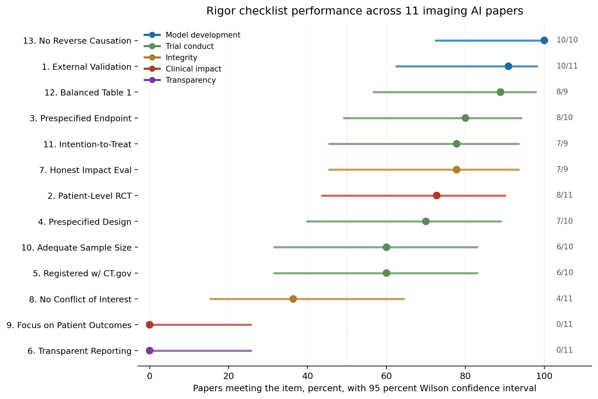

# Imaging Without Outcomes?

### A Targeted Rigor Appraisal of AI Based Imaging Prediction Tools in Medicine

Adam T. Lane

4 August 2026

---

## Abstract

**Background.** Papers announcing medical artificial intelligence tools are evaluated almost
invariably on how well the model discriminates. That is a claim about the model rather than about the
patient. Between the two lies a chain of evidence running from internal accuracy, through external
validation and prospective evaluation, to a demonstration that a patient was better off. This study
asks where in that chain the published imaging artificial intelligence literature stops.

**Methods.** Fifteen papers were identified through a prespecified PubMed search covering January
2018 to July 2026 and appraised in full against the thirteen item rigor checklist taught in Module 9
of this course, producing one hundred and ninety five verdicts each supported by a written
justification quoting the passage that settles it. The primary analysis covers eleven imaging papers,
four in retinal screening and seven in colonoscopy. Four electrocardiography papers form a
prespecified secondary set reported separately. The checklist's own worked example, a randomised
trial of a paediatric thromboembolism prognostic model, was scored as an external reference case. A
rule fixed in advance governed when an item could be marked not applicable, and never permitted it on
the two items measuring clinical impact. Proportions carry Wilson score 95 percent confidence
intervals. The central comparison is between two items scored on the same papers and was analysed
as paired data with an exact McNemar test.

**Results.** External validation was satisfied by ten of the eleven imaging papers and a genuine
patient outcome was the primary endpoint of none of them, a paired difference of 90.9 percentage
points with a 95 percent confidence interval from 52.3 to 98.4 and an exact McNemar p value of
0.0020 on ten discordant papers. No paper fell the other way. Transparent reporting of the model was
also satisfied by no paper, so the evidentiary chain breaks at both ends rather than at one. Four of
the eleven papers were independent of the maker of the tool they evaluated. Six of the eight
randomised trials built their power calculation on a baseline event rate the observed data
contradicted. The reference
case satisfied twelve of thirteen items. An independent reader working only from the written rules
reproduced the appraiser's verdicts with a Cohen's kappa of 0.686, and the disagreements concentrated
in judgments about whether an item applied rather than about what a paper reported.

**Conclusions.** This literature establishes reliably that its models discriminate and follows
correct trial procedure, while never establishing that the models are inspectable or that they change
what happens to patients. The failure is structural rather than individual, since several of these
papers are candid about precisely this limitation and the field is measuring what it has collectively
agreed to measure.

---

## 1. Introduction

A paper announcing a medical artificial intelligence tool almost always reports how well the model
discriminates. Area under the curve, sensitivity, specificity. These are claims about the model.
They are not claims about the patient, and the distance between the two is larger than the
literature's own framing usually admits.

Between a model that discriminates and a patient who is better off lies a chain of evidence with
several links. A model must first perform on data it was not fitted to. It must then hold up on data
from another site or another period, since a model that only works where it was built is a local
curiosity. It must then be placed in front of clinicians in a real care pathway, because a model
that performs in silico may change nothing when a busy person is free to ignore it. And finally the
pathway containing the model must be shown to leave patients better off than the pathway without it.
Each link is a separate empirical claim. Establishing one does not establish the next, and a
literature can accumulate a great deal of evidence for the early links while producing almost none
for the last.

This project asks where in that chain the published imaging artificial intelligence literature
actually stops.

## 1.1 Why the distinction carries particular weight in this literature

Every field has surrogate endpoints, and their limitations are well understood in general terms. The
imaging artificial intelligence literature has a more specific problem, which is that its dominant
endpoints are properties of the examination rather than properties of the patient.

In colonoscopy the standard endpoints are the adenoma detection rate and the number of adenomas
found per procedure. Both are measures of what the examination found. Neither is a measure of what
happened to the person examined. The link between finding more adenomas and preventing more cancers
is plausible, is supported for detection rates in the historical literature, and is not the same
claim. A tool that finds more small polyps raises the detection rate by construction, and whether it
prevents any cancer is a separate question that a detection endpoint cannot answer.

In retinal screening the equivalent endpoints are referral rates and screening uptake. These measure
what the health system did. Whether anyone kept their sight is again a separate question.

The consequence is that a trial can be well designed, honestly reported, adequately powered and
entirely positive, and still tell a reader nothing about whether patients benefited. That is not a
flaw in any individual study. It is a property of what the field has collectively agreed to measure,
and it is invisible unless someone counts.

## 1.2 Why imaging

Imaging is where medical artificial intelligence has travelled furthest into practice. Autonomous
diagnostic systems have regulatory clearance, computer aided detection is installed in endoscopy
suites and reimbursed, and screening programmes in several countries now run with algorithmic
assistance. If the evidentiary chain is incomplete anywhere it matters, it matters here, because
these are the tools already in front of patients rather than the tools proposed for them.

Imaging also offers something methodologically useful. Two of its subfields, retinal screening and
colonoscopy, have each produced completed randomised trials of clinical impact rather than
diagnostic accuracy studies alone. That makes it possible to appraise trials that genuinely
attempted the later links in the chain, rather than only observing that most papers never attempt
them.

## 1.3 The appraisal approach

The question is answered by structured appraisal rather than by argument. A defined set of published
papers was identified through a prespecified search, and each was read in full and scored against a
fixed thirteen item rigor checklist covering external validation, trial design and conduct, honest
reporting, independence from the manufacturer, transparency of the model, and whether the primary
endpoint was a genuine patient outcome.

A narrative review could assert that the field measures surrogates. An appraisal can say how often,
on which items, with what uncertainty, and against a reference point. The unit of analysis is the
paper by item cell, which makes the failures countable and locates them rather than describing them.

The instrument is the appraisal checklist taught in Module 9 of this course. Its worked example is a
randomised trial of a paediatric thromboembolism prognostic model, a study outside imaging that the
source marks as satisfying all thirteen items. That example matters for two reasons. It shows the
items are jointly satisfiable, so a literature failing them is failing something achievable rather
than an unreachable standard. And it supplies an external reference point, since the same instrument
already has an established application in another domain against which imaging can be compared. That
trial is appraised here as a reference case alongside the imaging papers.

## 1.4 Hypothesis

The hypothesis was fixed in the proposal before any paper was scored. It holds that these papers will
score well on the items asking whether the model works and poorly on the items asking whether it
helps patients, and that the distance between the two will prove wider in imaging than in the domain
where the checklist was first applied.

The prediction is directional and was registered as such. Both the item level contrast and the group
level contrast were named in advance, and no other comparison in this appraisal is tested.

## 1.5 What this paper contributes

Three things beyond the headline count.

A quantified location for the break in the evidentiary chain, reported as a paired contrast on the
same papers rather than as two independent proportions, with an exact test and an interval.

An operational definition separating patient outcomes from surrogate and process measures, arranged
as four tiers with an explicit test for the boundary that matters, and applied to every primary
endpoint in the collection. The distinction is the one on which the central finding rests, so it is
stated in a form another appraiser can apply rather than left to judgment.

And an account of the instrument itself. Applying a rigor checklist carefully to fifteen papers turns
out to expose as much about the checklist as about the papers, including which items discriminate,
which penalise defensible design choices, and which parts of it a second independent reader cannot
reliably reproduce.

---

## 2. Methods

## 2.1 Design

This is a targeted rigor appraisal rather than a systematic review. A defined set of published
papers describing imaging based artificial intelligence tools was identified through a prespecified
search, and each paper was scored against a fixed thirteen item checklist. The term systematic
review is deliberately not claimed. The protocol named two secondary databases that were not
searched, and it was frozen after ten of the fifteen papers had already been scored, so both
shortfalls are reported in the limitations rather than absorbed into a stronger label. The unit of
analysis is the paper by item cell, and the outcome is the proportion of papers satisfying each
item.

The study tests two claims stated in the proposal before any appraisal was carried out. First,
that these papers score well on the items asking whether the model works and poorly on the items
asking whether it helps patients. Second, that the distance between those two groups is wider in
imaging than in the domain where the checklist was first applied.

---

## 2.2 The instrument

### Source

The checklist is the thirteen item appraisal instrument taught in Module 9 of the course, held at
`Refs/Lecture 9A Slides.pdf`. The items appear as a table on slide 3, repeated unchanged on slide
31, under the heading "Feature of the AI Project and Evaluation Approach" beside a second column
headed "Our Typical Approach". The lecture applies the instrument to a single exemplar, the CLOT
trial of a paediatric venous thromboembolism prognostic model, reported across three papers and
marked as satisfying all thirteen items.

All thirteen items are reproduced from that source in the same order. None was added, dropped or
reordered. Where the wording used here is longer than the slide, the additional wording is drawn
from the lecture's own explanatory slides and is cited item by item in
`Drafts/checklist_provenance.md`. One elaboration, the phrase "external temporal or geographic" in
item 1, is this study's own gloss and is declared as such.

### Items

**Table 1.** The thirteen checklist items, reproduced from the source instrument in the order given there.

| # | Item |
| --- | --- |
| 1 | External validation of the model |
| 2 | Pragmatic patient level randomised controlled trial of impact |
| 3 | Prespecified primary endpoint |
| 4 | Prespecified study design |
| 5 | Registered with ClinicalTrials.gov |
| 6 | Transparent reporting of the model, as opposed to black box or proprietary |
| 7 | Honest, rigorous evaluation of the impact published |
| 8 | Clear of any conflict of interest |
| 9 | Focus on improving patient outcomes |
| 10 | Sufficiently large sample size |
| 11 | Analysis based on the intention to treat principle |
| 12 | Two study arms are balanced in Table 1 |
| 13 | Avoided reverse causation or data leakage |

### Response scale

Each item takes one of four verdicts. `Yes`, `No`, `Unclear`, `N/A`. No numeric or ordinal scale
was used, because the items are questions of fact rather than of degree and because a numeric
scale would blend confidence with magnitude in a way that cannot afterwards be separated.

`Yes` counts in the numerator and the denominator. `No` and `Unclear` count in the denominator
only, so both lower a rate. `N/A` is excluded from both and therefore never counts against a
paper.

### When N/A is permitted

Marking an item `N/A` because a paper's design does not reach it is superficially fair and, for
two items, destroys the quantity under study. If only papers that ran an impact trial are scored
on whether they ran an impact trial, the denominator collapses onto exactly the papers that pass.

Items were therefore assigned to four classes, and `N/A` is available only where the class permits
it. This rule was adopted at the third paper scored and applied to every paper thereafter and
retrospectively to the first two.

**Table 2.** The item class rule governing when an item may be marked `N/A`.

| Class | Items | `N/A` permitted when |
| --- | --- | --- |
| A | 2, 9 | Never. These two are the quantities under study |
| B | 3, 4, 5, 11, 12 | The paper has no trial arms |
| C | 7 | The paper contains no impact evaluation at all |
| D | 1, 6, 8, 10, 13 | Never. Scored for every paper regardless of design |

### When Unclear is used

`Unclear` is a substantive verdict rather than missing data. Two conventions were fixed in advance
of the papers to which they applied.

Items 3 and 4 take `Unclear` rather than `No` when a trial is unregistered, because self reported
prespecification cannot be checked against any external record.

Item 5 takes `Unclear` when a trial was registered prospectively in a registry other than
ClinicalTrials.gov, because scoring `No` would wrongly equate prospective registration elsewhere
with reporting no registration at all.

### Operationalising item 9

Item 9 asks whether the endpoint is a genuine patient outcome. Applied to this literature a binary
reading proved to conceal a distinction, because endpoints fail the item at four different
distances from the patient. Every primary endpoint was therefore assigned to one of four tiers,
and item 9 scores `Yes` only at tier four.

**Table 3.** The four tier endpoint taxonomy operationalising item 9.

| Tier | Definition | Item 9 |
| --- | --- | --- |
| 1 | Model performance metric, a property of the classifier computed outside any care pathway | `No` |
| 2 | Process measure, what the health system or clinician did | `No` |
| 3 | Surrogate or intermediate clinical finding, located in the patient but not experienced by them | `No` |
| 4 | Patient outcome, an event or state the patient experiences | `Yes` |

The operative test for tier four is whether the patient would experience the thing if nobody told
them about it. Two rulings follow. Diagnosing a disease is tier three, because a diagnosis changes
what is known about a patient rather than what happens to them. A model performance metric remains
tier one even when the predicted target is a genuine outcome, because predicting an outcome is not
measuring one.

Item 9 is scored on the primary endpoint alone. Composite and co primary endpoints take the lowest
tier among their components. Full definitions, boundary rules and the classification of every
endpoint in the study are in `Drafts/operational_definitions.md`.

**Disclosure.** These definitions were written after all papers were scored and formalise the rule
applied during scoring. They were not prespecified. What can be verified, and has been, is that
every item 9 verdict follows from the tier assignment with no exceptions and no discretionary
calls.

### Modification to item 8, and its correction

One substantive departure from the source occurred and was corrected during the study.

The source reads "Clear of any conflict of interest". From the first paper scored until 2 August
2026 the item was applied as "The study is clear of undisclosed conflicts of interest". That is a
different question. Under the narrowed wording the item returned no negative verdict in sixteen
papers and became one of four columns holding a single value, and that degeneracy was initially
written up as a limitation of the instrument.

On obtaining the source the modification was identified, the wording reverted, and all sixteen
papers rescored with sign off on 2 August 2026. The earlier finding was withdrawn.

Read at maximum strictness the reverted item fails the lecture's own exemplar, because an author
of the CLOT trial declares fees from seven anticoagulant manufacturers while the trial's
intervention is a recommendation to begin anticoagulation. Since the source marks that exemplar as
satisfying all thirteen items, the intended threshold must be narrower than the literal reading.
The rule adopted is the strictest under which the exemplar still passes.

> A conflict exists when an author or the study has a financial or ownership interest in the
> specific tool under evaluation, or when the tool's maker funded or sponsored the study.
> Equipment loan alone does not count. Relationships with unrelated products do not count.

The rule was fixed and recorded before any paper was rescored. Two verdicts under it are flagged
in their scoring notes as genuinely arguable. The full account, including the effect on every
downstream figure, is in `Drafts/checklist_provenance.md` and deviation D10.

### Instrument freeze

The instrument was frozen on 2 August 2026, recorded as deviation D11. The item wordings, the item
class rule, the `Unclear` conventions, the tier taxonomy and the item 8 threshold are closed to
further change while the reliability assessment is outstanding, because a change made after the
second rating begins would render the two sets of verdicts incomparable and would present an
instrument revision as rater unreliability. Any wording problem identified after that date is
reported as a limitation rather than corrected.

---

## 2.3 Eligibility criteria

Inclusion required all of the following. A primary report of a prospective clinical study
evaluating an imaging based AI tool in human patients. An imaging domain of retinal imaging,
colonoscopy video or twelve lead electrocardiography. A design that is a randomised trial of any
randomisation unit, a prospective diagnostic accuracy or pivotal trial, or a model development
study with prospective or external clinical evaluation. Publication between 1 January 2018 and 28
July 2026. English full text. Full text obtainable.

Any one of the following excluded a record. Systematic review, meta analysis or pooled analysis.
Editorial, commentary, letter or conference abstract. Protocol or design only paper reporting no
results. Secondary, companion, post hoc or qualitative analysis of a trial reported elsewhere.
Retrospective only model development with no prospective or external clinical evaluation. Non
human, phantom or simulation study. Duplicate report of a trial already included.

---

## 2.4 Information sources and search

The search protocol was written and frozen on 28 July 2026, before the expansion search was run
and before any candidate paper was viewed, and is held in the `Search Protocol` sheet of the
tracker.

The database was PubMed and MEDLINE. The publication window ran from 1 January 2018 to 28 July
2026, the lower bound set by the earliest paper already held. The search was executed on 28 July
2026. Three full search strings, one per domain, are recorded in PubMed syntax in the protocol.

**Disclosure.** Embase and Web of Science were declared in the protocol as secondary sources to be
used if PubMed returned fewer eligible records than a domain quota required. That condition was met
in the retinal domain and the secondary databases were not run. The shortfall was instead handled
by revising the target downward, logged as deviation D1. Searching a single database is a
limitation of this study.

**Disclosure.** The protocol was frozen after ten of the fifteen appraised papers had already been
scored. Those ten were not selected under it. The protocol governed the expansion from ten to
fifteen and governs any future addition.

---

## 2.5 Selection

Where eligible candidates exceeded a domain quota, selection ran in descending order of
publication date. Recency was chosen because it is independent of the checklist result. Ranking by
citation count would bias toward positive and widely promoted trials and ranking by sample size
would bias toward industry funded ones.

Every record assessed at full text was recorded with an include or exclude decision, the criterion
invoked and a reason, whether or not it entered the final set. Eighteen records are logged in the
`Screening Log` sheet. Records that were eligible but fell outside a quota are retained as
supporting evidence rather than discarded.

**Verification.** Before entry to the manifest, the downloaded file was opened and page one read,
and the first author, journal, publication year and study design confirmed against the intended
record. A file failing any of the four does not enter the manifest and is filed separately with
the mismatch logged. This step exists because two of the original twelve files, seventeen percent,
contained a different paper from the one the manifest named. On its first application to eight new
downloads the step rejected two further files.

---

## 2.6 Analysis sets

**Primary set.** Eleven papers, four retinal and seven colonoscopy. Every headline figure
describes this set.

**Secondary set.** Four electrocardiography papers, reported separately and never pooled into a
headline figure. A twelve lead electrocardiogram is a time series rather than an image, so these
papers cannot sit within an appraisal of imaging. They are retained because they supply the only
tier four primary endpoint in the collection and the clearest single demonstration that process
measures and patient outcomes can move in opposite directions within one trial. The narrowing
follows peer feedback on the proposal and is logged as deviation D7.

**Reference case.** One further paper, the CLOT trial, scored on the same thirteen items under the
same conventions and held on a separate sheet excluded from every summary and export. It is the
trial to which the instrument was applied in its original non imaging domain and it anchors the
second clause of the hypothesis. Because the original application is a single trial, that clause is
reported as an illustrated contrast against one comparator and explicitly not as a statistical
comparison.

**Supporting papers.** Five further papers are documented but not scored, each with the exclusion
criterion that placed them there.

The domain comparison stated as an aim in the proposal is withdrawn. It cannot be supported at this
sample size and the interval analysis demonstrates rather than asserts this. It is reported as a
demonstrated negative result.

---

## 2.7 Scoring procedure

Every verdict was assigned by reading the full paper. No verdict was assigned by keyword search.

Verdicts were assigned by a single human appraiser working with the assistance of a large language
model. For each paper the model was given the full text and the instrument and proposed all
thirteen verdicts with written reasoning. The appraiser reviewed each proposal against the paper
and confirmed, amended or rejected it before anything was written to the record. The appraiser is
accountable for every verdict and no verdict entered the record without explicit sign off.

This is disclosed for two reasons. A reader assessing the appraisal is entitled to know how the
verdicts were produced. And it constrains the choice of second rater, because a model drawn from
the same family as the one that assisted here would share its training and its characteristic
errors, so agreement between the two would measure very little. Any model used in the reliability
assessment therefore comes from a different developer, and that requirement is recorded in
deviation D12.

Papers were scored one at a time. For each paper all thirteen verdicts were proposed with written
reasoning and confirmed before any cell was written to the record. No batch scoring was performed
and no verdict was entered without sign off.

Each paper carries a written justification note recording the evidence for every verdict, with
section or page locators and quoted wording where the wording is the point. Notes run between
roughly two and a half thousand and five thousand characters per paper. Where a verdict was
amended after initial scoring, the amendment is appended with its date, its prior value and its
reason, and the superseded reasoning is retained for audit rather than deleted.

A software notebook extracts candidate evidence from each PDF by regular expression and reports
where the relevant language appears, with a page reference and a snippet. **It does not assign
verdicts.** An earlier version offered automatic suggestions for two items. The intention to treat
suggestion was checked against five papers and was wrong in five of five, by four distinct
mechanisms, and both suggestion columns were withdrawn.

---

## 2.8 Reliability

The procedure for a second rating was fixed in advance of any rating and is held in
`Drafts/second_rater_protocol.md`. It specified that a second rater would independently score a
subset of the papers.

A fallback was specified in advance as well, before any fallback rating was run and before any
fallback result was seen. It is held in `Drafts/fallback_rater_protocol.md` and recorded as
deviation D12. It fixes the order of preference among possible raters, which runs from an
independent human with relevant background, to an independent human from another analytical field,
to a frontier language model from a developer other than the one whose assistant supported the
first rater. It also fixes what each may be called. The two human options support inter rater
agreement in the ordinary sense. The model option supports a reproducibility check on the
instrument and is not reported as inter rater reliability anywhere. If a human rating arrives at
any point before submission it becomes the primary result automatically, whichever of the two
produces the higher agreement.

Five of the fifteen papers were selected by seeded random draw stratified by domain, seed
20260729, giving sixty five cells. The draw was random rather than purposive, because selecting
the papers that appeared hardest would depress agreement by construction.

The draw preceded the narrowing of scope described above, so four of the five selected papers fall
in the primary imaging set and one falls in the secondary set. The sample was not redrawn, because
the first rater's verdicts on all fifteen papers were already known when the narrowing was made,
and a redraw at that point would have been a selection informed by the data. The primary agreement
figure is therefore computed across all sixty five cells and covers four of the eleven primary
papers and one of the four secondary papers. A figure restricted to the four imaging papers was
declared in advance as an optional additional descriptive, so that the choice between the two could
not be made after the numbers were seen. That option was not exercised. This is recorded as
deviation D8.

The packet prepared for the second rater carried the papers, the full item wordings, the item class
rule, the `Unclear` conventions, the tier definitions and a blank form. It carried no existing
verdict, no justification note, no summary or export, and no statement of what the study predicts.
The rules were shared deliberately, because a reliability study measures whether two raters
applying the same stated rules reach the same verdicts, not whether they independently invent the
same rules.

The protocol fixed the analysis before any rating was seen. Agreement would be computed on the
independent ratings before any discussion between raters, and would never be recomputed after
reconciliation. Three coefficients would be reported together, because no single one is
trustworthy on data this skewed toward `Yes`. Cohen's kappa on the substantive categories, raw
percent agreement, and a prevalence adjusted statistic. Per item kappa would not be computed for
items where one category holds every cell, since it is unstable or undefined there even under
perfect agreement. Concordance on `N/A` placement would be reported separately as a test of the
item class rule.

Disagreements were to be logged with both verdicts and both notes and then reconciled by
discussion, and any verdict changed as a result was to be recorded with its prior value and date.
That step assumed a human rater on the other side of it.

No human rater came forward, and the fallback was executed on 3 August 2026 as run 1 of the three it
specifies, recorded as deviation D14. Because the rater was a model with no memory, there was nobody
to reconcile with, so the disagreements are reported and the first rater's verdicts stand. The
agreement figure was computed once from the independent ratings and is not recomputed. Results
section 3.11 reports it as a reproducibility check on the instrument rather than as inter rater
reliability, in the terms fixed in advance by D12. All three passes specified by that protocol were
completed, and results section 3.12 reports the rater's stability against itself, computed on the
raw verdicts before the quotation gate because that gate protects the comparison against rater 1 and
has no bearing on the model's own variance.

---

## 2.9 Statistical analysis

Every interval reported in this paper is a two sided 95 percent confidence interval, abbreviated CI
in tables. Several items
sit at or near a boundary, so no normal approximation interval was used anywhere.

Single proportions carry Wilson score confidence intervals, with exact Clopper-Pearson intervals computed
alongside as a check. The comparison between item 1 and item 9 is paired, because both were scored
on the same papers, and uses the Newcombe interval for paired proportions with an exact McNemar
test on the discordant pairs. The group level contrast uses a sign test over papers.

Pooled group rates count several cells from each paper and those cells are not independent. A
cluster bootstrap resampling whole papers was computed for every group. With so few clusters the
bootstrap proved unreliable at boundaries, collapsing to zero width where a column holds a single
value, so the interval reported for each group follows a rule fixed in advance rather than chosen
once the numbers were visible. Groups built from a single item are unclustered and take Wilson. For
multi item groups the cluster bootstrap is reported unless it is narrower than the naive interval,
in which case the wider naive interval is taken. The rule and the method it selected for each group
are recorded in the exported data.

Two contrasts are tested, both stated in the proposal before the appraisal began. All other figures
are estimation rather than testing, so no correction for multiple comparisons is applied.

---

## 2.10 Reproducibility

The complete record is a spreadsheet workbook containing the item definitions, the paper manifest,
every verdict with its justification, the search protocol, the screening log and the deviations
log. All analysis runs in Python notebooks under version control of their outputs, with package
versions pinned. Python 3.13.14 was used throughout.

The appraisal record contains no live formulas. All derived values are written as static values by
a refresh notebook that also regenerates the exported data, so that every reported figure can be
traced to the verdicts it came from and regenerated from them.

---

## 2.11 Deviations

Sixteen deviations from the protocol are logged with dates and rationale in the `Search Protocol`
sheet, covering the revised target, two records that could not be obtained, an authorship
concentration in one domain, two files rejected at verification, two deviations recorded late on
audit, the scope narrowing, the decision not to redraw the reliability sample afterwards, the
unverified checklist provenance and its resolution, the item 8 reversion, the instrument freeze,
the fallback specified in advance for the reliability assessment, an amendment to the
transcription rule within that fallback, the execution of that fallback, the measurement of its
stability across three passes, and a data handling error in which the transcription step wrote the
completed model rating into the blank rater packet.

That error was found on 4 August 2026 by a check on whether a late human rating remained possible,
rather than by anything going wrong. No rater received the packet at any point while it held the
completed rating, and the agreement figure was verified to reproduce unchanged after the packet was
cleared. It is recorded here because a rigor appraisal that concealed a near miss in its own
reliability design would be committing the error it documents.

Papers weakening the hypothesis are reported rather than dropped, and findings that were reported
and later proved wrong are withdrawn in place rather than quietly replaced.

---

## 3. Results

## 3.1 The appraised set

Fifteen papers were appraised against all thirteen items, giving one hundred and ninety five
verdicts. One hundred and eighty four were scoreable and eleven were `N/A` under the item class
rule.

Eleven papers form the **primary set**, four from retinal imaging and seven from colonoscopy. They
were published between 2018 and 2026. One hundred and forty three verdicts fall in this set, of
which one hundred and thirty two are scoreable.

**Table 4.** The eleven papers in the primary analysis.

| Study | Design |
| --- | --- |
| Zhou 2023, Nature (RETFound) | Foundation model development |
| Abramoff 2018, npj Digital Medicine (IDx-DR) | Prospective diagnostic accuracy trial |
| Wolf 2024, Nature Communications (ACCESS) | Pragmatic randomised trial |
| Mathenge 2022, Ophthalmology Science (RAIDERS, Rwanda) | Investigator masked randomised trial |
| Repici 2020, Gastroenterology | Randomised trial |
| Ahmad 2023, Endoscopy (AI-DETECT) | Randomised trial |
| Wei 2023, American Journal of Gastroenterology (AI-SEE) | Multicentre randomised trial |
| Ladabaum 2023, Gastroenterology | Pragmatic implementation study |
| Alali 2025, Journal of Clinical Medicine (Kuwait) | Randomised trial |
| Kader 2025, npj Digital Medicine (EAGLE/CADDIE) | Pragmatic multicentre randomised trial |
| Hsu 2026, JAMA Network Open | Multicentre open label randomised trial |

Four electrocardiography papers form the **secondary set**, reported separately in section 3.9 and
never pooled with the primary set.

One further paper, the CLOT trial, is the **reference case** and is reported in section 3.10. Five
supporting papers were documented but not scored.

---

## 3.2 Performance by item group

**Table 5.** Proportion of items satisfied across the eleven imaging papers, grouped by the question the items ask.

| Item group | Items | Rate | 95 percent confidence interval |
| --- | --- | --- | --- |
| Model development | 1, 13 | 95.2 percent | 77.3 to 99.2 |
| Trial conduct | 3, 4, 5, 10, 11, 12 | 72.4 percent | 54.0 to 89.6 |
| Integrity | 7, 8 | 55.0 percent | 31.6 to 77.3 |
| Clinical impact | 2, 9 | 36.4 percent | 19.7 to 57.0 |
| Patient outcomes alone | 9 | 0.0 percent | 0.0 to 25.9 |
| Transparency | 6 | 0.0 percent | 0.0 to 25.9 |

Across all thirteen items the primary set satisfies 61.4 percent of scoreable cells, with a
95 percent confidence interval from 52.8 to 69.2.

### Item level

**Table 6.** Proportion of papers satisfying each item in the primary analysis set.

| # | Item | Met | Rate | 95 percent confidence interval |
| --- | --- | --- | --- | --- |
| 13 | Avoided reverse causation | 10 of 10 | 100.0 percent | 72.2 to 100.0 |
| 1 | External validation | 10 of 11 | 90.9 percent | 62.3 to 98.4 |
| 12 | Balanced Table 1 | 8 of 9 | 88.9 percent | 56.5 to 98.0 |
| 3 | Prespecified endpoint | 8 of 10 | 80.0 percent | 49.0 to 94.3 |
| 7 | Honest impact evaluation | 7 of 9 | 77.8 percent | 45.3 to 93.7 |
| 11 | Intention to treat | 7 of 9 | 77.8 percent | 45.3 to 93.7 |
| 2 | Patient level randomised trial | 8 of 11 | 72.7 percent | 43.4 to 90.3 |
| 4 | Prespecified design | 7 of 10 | 70.0 percent | 39.7 to 89.2 |
| 5 | Registered with ClinicalTrials.gov | 6 of 10 | 60.0 percent | 31.3 to 83.2 |
| 10 | Sufficiently large sample size | 6 of 10 | 60.0 percent | 31.3 to 83.2 |
| 8 | Clear of any conflict of interest | 4 of 11 | 36.4 percent | 15.2 to 64.6 |
| 6 | Transparent reporting | 0 of 11 | 0.0 percent | 0.0 to 25.9 |
| 9 | Focus on patient outcomes | 0 of 11 | 0.0 percent | 0.0 to 25.9 |

Denominators vary between nine and eleven because `N/A` is excluded from both numerator and
denominator.

**Figure 1.** Proportion of papers satisfying each checklist item across the eleven imaging papers,
ordered by rate and shown with 95 percent Wilson confidence intervals. The two items at zero, transparent
reporting and focus on patient outcomes, sit at opposite ends of the development chain.

---

## 3.3 The primary contrast

External validation was satisfied by ten of the eleven papers. A genuine patient outcome was the
primary endpoint of none of them.

Both items were scored on the same eleven papers, so the comparison is paired and was analysed as
such. Ten papers met external validation and failed the patient outcome item. Not one paper fell
the other way, and one paper failed both.

**Table 7.** The central paired contrast between external validation and patient outcomes.

| | |
| --- | --- |
| External validation | 90.9 percent, 95 percent confidence interval 62.3 to 98.4 |
| Focus on patient outcomes | 0.0 percent, 95 percent confidence interval 0.0 to 25.9 |
| Difference | 90.9 percentage points, 95 percent confidence interval 52.3 to 98.4 |
| Test | exact McNemar, p equals 0.0020, on ten discordant papers |

The same contrast at group level gives a difference of 58.9 percentage points with a 95 percent
confidence interval from 40.9 to 77.3. Ten of the eleven papers score strictly higher on model development than on
clinical impact, none score lower, and one is tied. Sign test p equals 0.0020.

Both contrasts were stated in the proposal before the appraisal began. No correction for multiple
comparisons is applied because no other figure in this section is tested.

---

## 3.4 Two columns with no positive verdict

Transparent reporting was satisfied by no paper in the primary set. A genuine patient outcome was
the primary endpoint of no paper in the primary set.

Reported with their uncertainty, both rates lie between 0.0 and 25.9 percent. Neither result
excludes a true rate approaching one paper in four. The finding survives at the upper bound of
both intervals, which is the reason to report the interval rather than the bare zero.

Transparency is also zero in the secondary set, so no paper anywhere in the collection reported
its model's predictors and their relative importance.

---

## 3.5 Conflict of interest

Four of the eleven papers in the primary set are independent of the maker of the tool they
evaluate.

In the remaining seven the authors were shareholders, directors or employees of the manufacturer,
held patents on the tested device, took consultancy fees from the manufacturer, or were employees
of the non profit organisation that built the system. In one case the manufacturer sponsored the
trial directly.

Rate 36.4 percent, interval 15.2 to 64.6. This is the third lowest scoring item in the appraisal.

**This item scored one hundred percent until 2 August 2026.** It had been applied under a wording
this study narrowed from "clear of any conflict of interest" to "clear of undisclosed conflicts of
interest", a modification that was not declared at the time and was identified only when the source
instrument was obtained. Under the narrowed wording the item returned no negative verdict in
sixteen papers, and that result was initially written up as a limitation of the instrument. The
wording was reverted to the source and every paper rescored. The earlier finding has been
withdrawn. The full account and the effect on every downstream figure are given in the methods and
in `Drafts/checklist_provenance.md`.

Disclosure in these papers is generally thorough. What the reverted item measures is whether an
interest exists, not whether it was declared, and on that measure most of this literature is
evaluated by parties with a stake in the result.

---

## 3.6 Power calculations

Eight of the eleven papers in the primary set were randomised trials.

Six of those eight built their power calculation on a baseline event rate that the observed data
contradicted. That is 75.0 percent with an interval from 40.9 to 92.9.

**Table 8.** Randomised trials whose power calculation rested on a baseline event rate the observed data contradicted.

| Trial | Assumed | Observed |
| --- | --- | --- |
| Ahmad 2023 | control polyp detection rate 20 percent | 79.7 percent |
| Alali 2025 | baseline adenoma detection rate 10 percent | 42.2 percent |
| Wei 2023 | pilot adenomas per colonoscopy 1.070 | 0.67 |
| Kader 2025 | adenomas per colonoscopy 0.83 | 0.62 |
| Repici 2020 | detection rate 35 percent in both arms | control arm 40.4 percent |
| Hsu 2026 | baseline adenoma detection rate 48 percent | 53.3 percent |

Wolf 2024 and Mathenge 2022 are the two trials whose assumptions held.

This was not a hypothesis of the proposal and emerged from the appraisal. It is not confined to
imaging. The reference case makes the same error in milder form, assuming ten events per thousand
and observing about seven, and one of the four secondary set trials makes it as well.

---

## 3.7 Scores by paper

**Table 9.** Items satisfied by each paper in the primary analysis set.

| Paper | Met | Rate |
| --- | --- | --- |
| Hsu 2026, JAMA Netw Open | 11 of 13 | 84.6 percent |
| Wolf 2024, Nat Commun (ACCESS) | 9 of 13 | 69.2 percent |
| Repici 2020, Gastroenterology | 9 of 13 | 69.2 percent |
| Kader 2025, npj Digital Medicine (EAGLE/CADDIE) | 9 of 13 | 69.2 percent |
| Abramoff 2018, npj Digital Medicine (IDx-DR) | 7 of 11 | 63.6 percent |
| Alali 2025, J Clin Med | 8 of 13 | 61.5 percent |
| Mathenge 2022, Ophthalmol Sci (RAIDERS) | 8 of 13 | 61.5 percent |
| Ahmad 2023, Endoscopy (AI-DETECT) | 7 of 13 | 53.8 percent |
| Wei 2023, Am J Gastroenterol (AI-SEE) | 7 of 13 | 53.8 percent |
| Zhou 2023, Nature (RETFound) | 2 of 5 | 40.0 percent |
| Ladabaum 2023, Gastroenterology | 4 of 12 | 33.3 percent |

Range 33.3 to 84.6 percent. Denominators differ because papers without trial arms have items
marked `N/A` under the item class rule, so Zhou is scored on five items and Ladabaum on twelve.

The lowest scoring paper is worth naming carefully. Ladabaum and colleagues report a deliberately
minimal real world implementation study, and a design of that kind forfeits several checklist items
at once. The score reflects the checklist's fit to the design, not the quality of the reporting,
which is among the most candid in the set.

---

## 3.8 Comparison across imaging domains

The proposal treated comparison between imaging domains as an aim. That aim is withdrawn, and the
evidence for withdrawing it is reported here as a negative result.

**Table 10.** Item level comparison between the two imaging domains, reported as a negative result.

| # | Item | Retinal, n equals 4 | Colonoscopy, n equals 7 |
| --- | --- | --- | --- |
| 1 | External validation | 75 (30 to 95) | 100 (65 to 100) |
| 2 | Patient level randomised trial | 50 (15 to 85) | 86 (49 to 97) |
| 3 | Prespecified endpoint | 100 (44 to 100) | 71 (36 to 92) |
| 4 | Prespecified design | 100 (44 to 100) | 57 (25 to 84) |
| 5 | Registered with ClinicalTrials.gov | 67 (21 to 94) | 57 (25 to 84) |
| 6 | Transparent reporting | 0 (0 to 49) | 0 (0 to 35) |
| 7 | Honest impact evaluation | 50 (9 to 91) | 86 (49 to 97) |
| 8 | Clear of any conflict of interest | 25 (5 to 70) | 43 (16 to 75) |
| 9 | Focus on patient outcomes | 0 (0 to 49) | 0 (0 to 35) |
| 10 | Sufficiently large sample size | 100 (44 to 100) | 43 (16 to 75) |
| 11 | Intention to treat | 100 (44 to 100) | 67 (30 to 90) |
| 12 | Balanced Table 1 | 100 (34 to 100) | 86 (49 to 97) |
| 13 | Avoided reverse causation | 100 (44 to 100) | 100 (65 to 100) |

Percentages with 95 percent confidence intervals in brackets.

Across the twenty six domain cells the mean interval width is fifty five percentage points and the
narrowest is thirty five. Every cell spans more than a third of the possible range and most span
more than half. No pair of domains can be separated on any item.

Eleven papers cannot support a comparison between imaging domains. Reporting this is more useful
than omitting it, because it indicates what sample size an appraisal of this kind would require.

---

## 3.9 The secondary set

Four electrocardiography papers, reported separately because a twelve lead electrocardiogram is a
time series rather than an image.

**Table 11.** Performance across the four electrocardiography papers in the secondary set.

| Item group | Rate | 95 percent confidence interval |
| --- | --- | --- |
| Model development | 100.0 percent | 67.6 to 100.0 |
| Trial conduct | 87.5 percent | 69.0 to 95.7 |
| Clinical impact | 37.5 percent | 0.0 to 75.0 |
| Integrity | 50.0 percent | 21.5 to 78.5 |
| Patient outcomes alone | 25.0 percent | 4.6 to 69.9 |
| Transparency | 0.0 percent | 0.0 to 49.0 |

At four papers every interval here is too wide to support a claim and none is offered. The paired
contrast between external validation and patient outcomes gives 75.0 percentage points but does not
reach significance, p equals 0.25, which is the best attainable at this sample size. The set is
reported because it supplies two things the primary set cannot.

**The only genuine patient outcome in the collection.** Lin and colleagues 2024 took all cause
mortality at ninety days as the primary endpoint and found it lower with the alert, 3.6 against 4.3
percent. This is an illustrative positive case. One favourable score does not validate the
checklist and no part of the argument rests on it.

**The clearest demonstration that the outcome distinction is not pedantic.** Liu and colleagues
2025 declared process measures as primary endpoints and genuine patient outcomes as secondary ones.
Two of four process endpoints improved significantly, with anticoagulant prescribing rising from
12.0 to 23.3 percent. Not one patient outcome moved. Ischaemic stroke, cardiovascular death and all
cause death were all null. The same trial therefore reports a clear positive on what the system did
and a null on what happened to the patients.

Conflict of interest is zero of four in this set, and transparency is zero of four.

---

## 3.10 The reference case

The CLOT trial is the study to which this instrument was applied in its original non imaging
domain. It is a pragmatic patient level randomised trial of a prognostic model for hospital
acquired venous thromboembolism in children, covering 17,427 hospitalisations, and it reported a
null result.

It satisfies twelve of the thirteen items, which is higher than any paper in the primary set.

**Table 12.** The reference case compared against the primary analysis set.

| Item | Primary set | Reference case |
| --- | --- | --- |
| 2. Patient level randomised trial | 8 of 11 | Met |
| 6. Transparent reporting | 0 of 11 | Met |
| 9. Focus on patient outcomes | 0 of 11 | Met |
| 8. Clear of any conflict of interest | 4 of 11 | Met |

The reference case satisfies all four of the items on which the primary set performs worst. Its
primary endpoint is an imaging confirmed thrombotic event, a genuine patient outcome. Its model is
an interpretable regression whose inputs are tabulated in the paper. The single item it fails is
intention to treat, where the analysis excluded 411 of 17,838 randomised patients after
randomisation.

**This is an anchor and not a test.** The instrument's original application is a single trial, so
the proposal's second clause is illustrated against one comparator rather than measured. It must
not be reported as a statistical comparison.

The reference case is also instructive in a way the checklist does not score. It satisfies almost
every item and still changed nothing, because the clinical teams declined to act on the model's
recommendation in roughly three quarters of eligible cases. A tool can pass every item on this
checklist and still fail the patient.

---

## 3.11 Reproducibility of the instrument

Five of the fifteen papers were rated a second time, sixty five cells in total, selected by seeded
random draw stratified by domain before any rating began. The draw preceded the narrowing of scope,
so four of the five sit in the primary imaging set and one in the secondary set. Fifty two of the
one hundred and forty three primary set cells are therefore dual rated.

**No independent human rater was obtained.** The second rating was produced by Gemini 3.6 Flash, a
large language model from a developer other than the one whose assistant supported the first rater,
under a fallback specified in advance and recorded as deviation D12. What follows is a reproducibility check
on the instrument and is not inter rater reliability in the ordinary sense. The distinction is not
cosmetic. It establishes whether the written instrument, applied by an independent reader with no
access to the verdicts, reproduces them. It does not establish how two people would differ. The
reviewer request for a second human reviewer was not met.

**Agreement on the substantive categories gives a Cohen's kappa of 0.686 with raw agreement of 83.0
percent**, across the forty seven cells that both raters scored. PABAK is 0.745 and Gwet's AC1 is
0.767. The three coefficients are reported together because the verdicts are skewed toward `Yes`
and no single one of them is trustworthy under that skew. The asymptotic interval runs from 0.488
to 0.884 and should be read as optimistic, since the cells cluster within five papers rather than
varying independently. Treating `N/A` as a fourth category lowers kappa to 0.591 and raw agreement
to 72.3 percent.

**The gap between those two figures is the finding.** Eighteen of the sixty five cells disagree, and
ten of the eighteen are disagreements about `N/A` placement rather than about substance. In those
ten, one rater judged an item inapplicable to the study design while the other scored it. The
instrument's substantive judgments reproduce considerably better than its rules about when an item
applies at all, and that is a specific and actionable weakness rather than a general one. Overall
concordance on `N/A` placement was 84.6 percent.

The item class rule itself held. Neither rater placed `N/A` on a class A item, which is the
protection that stops the two quantities the study measures from being excused on grounds of design.

**Table 13.** Per item agreement across the five dual rated papers.

| Item | Agreement | Note |
| --- | --- | --- |
| 2 Patient-Level RCT | 5 of 5 | |
| 7 Honest Impact Eval | 5 of 5 | |
| 9 Focus on Patient Outcomes | 5 of 5 | carries the central finding |
| 6 Transparent Reporting | 4 of 5 | |
| 13 No Reverse Causation | 4 of 5 | |
| 1 External Validation | 3 of 5 | most contested |
| 3, 4, 5, 8, 10, 11, 12 | 3 of 5 each | |

**Item 9 reproduced completely.** All five cells agree. That item carries the central result of this
study, so the claim that these papers validate their models far more often than they measure
patient outcomes is the claim least exposed to rater subjectivity. The most contested item was
item 1, external validation, at three of five.

**Two of the eighteen disagreements are artefacts of our own transcription rule** rather than
differences of judgment. A quotation gate converts any verdict asserting the presence of something
to `Unclear` when no verbatim quotation supports it. Two cells in paper 14 rested instead on numeric
evidence drawn from a CONSORT diagram and a baseline table, which is grounded in the paper but
cannot be quoted as prose. The rule was applied as written rather than amended a second time after
its effects were visible. Its cost runs in the conservative direction, depressing apparent agreement
rather than inflating it, and the figures above are therefore a floor.

**The rater's stated confidence carried no information.** It marked sixty four of sixty five cells
`High` and disagreed on twenty seven percent of those. Its single `Medium` cell also disagreed. A
human rater is asked to flag low confidence cells precisely because those are where an instrument is
doing least work, and this rater produced none. That is a real difference between model and human
rating and it limits what a model pass can substitute for.

**No reconciliation was possible.** The protocol's reconciliation step assumed a human on the other
side and there was nobody to discuss the disagreements with. They are therefore reported rather than
resolved, and the first rater's verdicts stand unchanged. Reading them for evidence of genuine error
remains legitimate, but any verdict changed on that basis is recorded with its prior value and date,
and the agreement figure above is fixed and is not recomputed.

**What this does and does not license.** A kappa of 0.686 is substantial on the Landis and Koch
convention, and it
supports the statement that the instrument is specified well enough that an independent reader
working only from the written rules reaches the same verdict in most cells. It does not support any
statement about how two clinicians would differ, it rests on a single rating pass, and its interval
is wide enough that the point estimate should not be quoted without it.

One further qualification runs in a helpful direction. Gemini 3.6 Flash is a fast tier model rather
than the most capable available, so these figures are better read as a floor for what a model rater
achieves against this instrument than as a ceiling. That does not strengthen any claim in this
paper. It does mean the weakness the check located, in the rules governing when an item applies,
is unlikely to be an artefact of using a small model, since a more capable rater would be expected
to reproduce the substantive verdicts better rather than the applicability rules worse.

---

## 3.12 Stability of the second rating

The five papers were rated three times rather than once. Each pass used the same model, the same
prompt and the same attachments, in a fresh session with no memory of the others. The purpose was to
separate stable differences of interpretation from run to run noise in the eighteen disagreements
reported above.

This measurement is available only because the second rater was a model. A person cannot be asked to
read a paper cold three times having forgotten the previous two, so intra rater stability is
ordinarily unmeasurable in an appraisal of this kind. It is reported here as a genuine methodological
gain rather than as compensation for the absence of a human rater.

**The rater is substantially self consistent.** Fleiss' kappa across the three passes is 0.844, with
observed agreement of 0.897 against 0.341 expected by chance. Fifty five of the sixty five cells came
back identical all three times, ten split two to one, and no cell produced three different answers.
Mean pairwise agreement across the three pairs of runs is 89.7 percent.

**Where that instability sits is the finding.**

**Table 14.** Stability of the model's verdicts, split by whether its first pass agreed with the first rater.

| | Cells | Unanimous across three runs | Rate |
| --- | --- | --- | --- |
| Run 1 disagreed with rater 1 | 17 | 10 | 58.8 percent |
| Run 1 agreed with rater 1 | 48 | 45 | 93.8 percent |

Where the model agreed with the first rater it reproduced itself almost perfectly. Where it
disagreed it could not reproduce its own verdict two times in five. The disagreements are
concentrated in the cells the model is least certain of.

**This cuts in two directions and both are reported.** A meaningful share of the disagreement is
noise rather than a competing reading that holds up, so the first rater's verdicts are not being
contradicted by a stable alternative interpretation. Equally, the model rater is least reliable
exactly where it is asked to do the most work, which bounds how much weight the reproducibility
check in section 3.11 can carry. Neither reading alters the figure reported there, which was
computed once and is not revised.

**One arithmetic point.** This section counts seventeen disagreements where section 3.11 counts
eighteen. The difference is not an inconsistency. Stability is computed on the raw verdicts before
the quotation gate, and the gate converted one cell in paper 14 from a verdict that agreed with the
first rater into `Unclear`, which does not. Our own transcription rule produced one of the eighteen
disagreements, and it is identifiable as a single named cell rather than a diffuse allowance.

**Two independent measurements converge on the same weakness.** Item 5, registration, is the least
stable item at two of five unanimous, with items 6 and 10 following at three of five. Seven of the
thirteen items were unanimous throughout. Four of the ten unstable cells are `N/A` boundary flips,
where the model moved between scoring an item and judging it inapplicable to the design. Since ten
of the eighteen disagreements with the first rater were also about `N/A` placement, the model cannot
reliably agree with the first rater about when an item applies, and cannot reliably agree with itself
either. That the two measurements are independent of one another makes the conclusion considerably
harder to dismiss. The item class rule is the least reproducible component of this instrument.

**Item 9 reproduced perfectly on both measures**, five of five unanimous across runs and five of five
in agreement with the first rater. The item carrying the central claim of this study is the one that
reproduces best, on both of the two ways the appraisal has been tested.

The modal verdict across the three runs would have agreed with the first rater on fifty of the sixty
five cells against the first pass's forty eight. That figure is descriptive. Substituting it would
inflate agreement against a rater who read each paper once, and the protocol fixed in advance forbids
it.

---

## 4. Discussion

## 4.1 The chain breaks in two places, not one

The hypothesis anticipated a single break. These papers would establish that the model works and
fail to establish that it helps patients. That break is present and it is wide. External validation
was satisfied by ten of the eleven papers in the primary set and a genuine patient outcome was the
primary endpoint of none of them, a paired difference of 90.9 percentage points with ten discordant
papers all falling the same way.

The data forced a correction to the framing. Transparency of the model is also a property of model
development, and no paper in the collection satisfied it. Not one reported which features its model
used or how much each contributed. That includes the electrocardiography papers and the reference
case, so the finding is not specific to imaging and not specific to any modality.

So the literature does not simply stop partway along the chain. It establishes the middle links
reliably, the discrimination and the trial conduct, and fails at both ends. These models are shown
to work and are not shown to be inspectable, and they are not shown to help. A reader who trusts
the published evidence is asked to accept a system they cannot examine on the strength of a benefit
that has not been measured.

The two failures are related. A field that cannot say what its model attends to has limited means of
predicting where it will fail, which raises the value of measuring downstream benefit directly. That
is precisely the measurement that is missing.

## 4.2 Where these tools measurably help, they help find what matters least

Several trials in this collection are positive, and the pattern inside those positive results is
more informative than the results themselves.

Repici and colleagues found their entire gain sat in adenomas below ten millimetres, with advanced
adenoma detection flat. Alali and colleagues found the gain concentrated in diminutive hyperplastic
polyps, which have no established malignant potential. Wei and colleagues found more resections
without more adenomas. Hsu and colleagues found the same and also quantified a cost, since computer
aided detection nearly doubled the proportion of patients assigned to intensive surveillance.

These systems reliably find more of the lesions least likely to become cancer, and they thereby
commit more patients to more frequent examination. Whether that trade is favourable is an open
question. It is not one that a detection endpoint can address, and the checklist does not capture
the pattern at all, since a trial can satisfy every item while producing exactly this result.

## 4.3 The failure is not dishonesty

It would be easy to read these findings as an indictment of the authors. That reading is wrong and
the evidence contradicts it.

Honest reporting scored 77.8 percent, and several papers are candid to a degree worth stating
plainly. Ladabaum and colleagues raised the possibility that their own technology had degraded
examination quality by producing a false sense of comfort. Wei and colleagues, whose trial was
sponsored by the device manufacturer, published a null result and wrote that they did not expect a
larger study to change it. Kader and colleagues stated outright that their trial did not examine
longer term patient outcomes and that the link between their endpoint and post colonoscopy cancer is
only weakly supported.

These authors are not concealing weak results. They are measuring what the field has agreed to
measure, and the field has agreed to measure detection. The problem is structural rather than
individual, which matters because structural problems are not fixed by asking investigators to try
harder. They are fixed by changing what counts as an acceptable primary endpoint, which is a decision
for funders, journals and regulators rather than for any single trial.

The power calculation finding points the same way. Six of the eight randomised trials in the primary
set built their sample size on a baseline event rate the observed data went on to contradict, and the
reference case makes a milder version of the same error. That is a field wide calibration problem
with the literature these trials plan against, not a series of individual mistakes.

One paper does not fit that pattern and is recorded here rather than smoothed over. Ahmad and
colleagues reported a randomised trial of six hundred and fourteen patients that carries no trial
registration of any kind. A full text search for every major registry identifier returns nothing,
and the paper contains no ethics statement and no funding statement. It also states that it was
reported according to CONSORT-AI, a standard that requires trial registration to be reported. This
is a reporting failure rather than a structural one, and it is the only instance of its kind in the
collection. It is noted because an argument that the problems of this field are structural is
strengthened rather than weakened by identifying the single case where the ordinary expectations of
reporting were claimed and not met.

## 4.4 Most of this literature is evaluated by parties with an interest in the result

Four of the eleven primary set papers are independent of the maker of the tool they evaluate. In the
remaining seven, authors were shareholders, directors or employees of the manufacturer, held patents
on the tested device, took consultancy fees from the manufacturer, or the manufacturer sponsored the
trial directly.

Disclosure in these papers is generally thorough, which is the point worth drawing out. The item that
produced this finding asks whether an interest exists, not whether it was declared. Applied as a
disclosure question it returns almost nothing, because this literature discloses well. Applied as an
independence question it returns 36.4 percent. The same body of papers looks compliant or
compromised depending on which question is asked, and the distinction between the two is easy to
lose.

This finding compounds the endpoint finding rather than sitting beside it. A field that measures
surrogates and is largely evaluated by interested parties has two independent reasons for its
positive results to overstate patient benefit.

## 4.5 The appraisal says as much about the instrument as about the papers

Applying a rigor checklist carefully to fifteen papers exposed several things about the checklist.

The item requiring patient level randomisation penalises a defensible design choice. Cluster
randomised trials score a negative verdict, yet for a tool that alerts a clinician rather than
treating a patient, cluster allocation arguably removes contamination and is the more rigorous
design. The sharpest illustration is that Ladabaum and colleagues scored lowest in the entire
collection while producing its most candid document, because a deliberately minimal real world design
forfeits several items at once. An instrument that ranks the most honest paper last is measuring
something other than what it claims to measure, at least in part.

The conflict of interest item taught a harder lesson, and the fault was ours. This project applied it
in a narrowed form, asking about undisclosed conflicts rather than any conflict. Under that wording
the item returned no negative verdict across sixteen papers, and that degeneracy was written up as a
limitation of the instrument. On obtaining the source the modification was found, the wording
reverted, every paper rescored and the earlier finding withdrawn. The item then fell to 36.4 percent
and became one of the more discriminating in the set. A single word had converted a substantive
finding into an artefact, and the artefact was more comfortable to report than the finding.

A third gap concerns what the instrument never asks. The checklist asks whether a study randomised
individual patients, whether its arms were balanced and whether it enrolled enough of them, but it
nowhere asks what the control arm actually received. Mathenge and colleagues scored positively on
all three of those items. Their intervention arm received artificial intelligence grading with
immediate feedback while their control arm received human grading communicated three to five days
later, so the arms differ both in who read the image and in how long the patient waited for the
result. A difference in referral adherence between them cannot be attributed to the artificial
intelligence rather than to the speed of the answer. Nothing in the thirteen items is capable of
raising that objection. An instrument that examines how patients were allocated but not what they
were allocated to will pass a confounded comparison without comment.

## 4.6 The least reproducible part of a rigor instrument is its own rule about applicability

The reliability work produced a result that generalises beyond this study.

An independent reader working only from the written rules reproduced the appraiser's verdicts with a
Cohen's kappa of 0.686. Where that reader disagreed, the disagreements were not spread evenly across
the instrument. Ten of the eighteen concerned whether an item applied to a study at all rather than
what the paper said. Rating the same papers three times cold produced the same concentration, with
four of the ten unstable cells being judgments about applicability and the registration item proving
least stable of the thirteen.

Two measurements that do not depend on one another point at the same component. The substantive
questions in this checklist are reproducible. The rule governing when a question is exempt is not.

That is worth stating because applicability rules are the least examined part of appraisal
instruments generally. They are usually a sentence or two, treated as bookkeeping, while the item
wordings receive careful attention. This project found that its own applicability rule was the single
most consequential methodological decision it made, since allowing design based exemption on the two
items that carry the hypothesis would have collapsed the denominators onto exactly the papers that
pass. Having established that the rule matters that much, the finding that it is also the least
reproducible part of the instrument deserves more attention than checklists usually give it.

---

## 5. Limitations

The sample is small. Eleven papers support the primary analysis, and the resulting intervals are
correspondingly wide, with no individual item rate estimated to better than twenty six percentage
points. What follows from this is a clear division that the paper will state explicitly. The
direction of the central effect is established beyond reasonable doubt, because the comparison is
paired and every paper that differs falls the same way. The magnitude is not established. A claim
that these papers validate their models far more often than they measure patient outcomes is
supported. A claim that some precise percentage of papers behaves in a particular way is not.

Only one database was searched. The protocol named Embase and Web of Science as secondary sources
to be used if PubMed returned too few eligible records in any domain. That condition was met in
retinal imaging, where completed impact trials proved scarce, and the secondary databases were
nonetheless not searched. The shortfall was instead handled by reducing the target number of
papers. This is the principal reason the study is presented as a targeted appraisal rather than as a
systematic review, and the scarcity of retinal impact trials, while consistent with the argument the
paper makes, cannot be offered as evidence for it on the strength of a single database.

The search protocol was frozen partway through the appraisal. Ten of the fifteen papers had
already been scored when the protocol was written, so those ten were not selected under it. The
protocol governed the expansion from ten to fifteen and governs any future addition, but the paper
will not claim that the whole sample was assembled prospectively.

Comparison between the imaging domains cannot be supported. Four retinal and seven colonoscopy
papers give domain by item cells whose mean interval width is fifty five percentage points, and no
pair of domains can be separated on any item. The proposal treated this comparison as an aim and
the aim is withdrawn. It is reported as a demonstrated negative result rather than omitted, since
it indicates the sample size such a comparison would require.

Verdicts were assigned by a single appraiser working with model assistance, and the second rating
that would ordinarily bound that limitation was itself produced by a model rather than by an
independent person. No human second rater was obtained. A fallback specified in advance for exactly
that outcome returned a Cohen's kappa of 0.686 on the substantive categories with 83.0 percent raw
agreement, which is substantial by convention. What that figure establishes is that the written
instrument reproduces its verdicts in the hands of an independent reader who has no access to them.
It does not establish how two clinicians would differ, and it does not meet the reviewer request for
a second human reviewer, which the paper states plainly rather than presenting the model pass as an
equivalent.

The check has one further limit that only became visible when the same five papers were rated three
times. The rater reproduced itself on 93.8 percent of the cells where it agreed with the appraiser
and on only 58.8 percent of the cells where it disagreed. Its disagreements are concentrated where
it is least certain, so it is least reliable exactly where it is asked to do the most work. That
bounds what any single model pass can establish, and it is the reason three passes were specified in
advance rather than one.

The most useful thing the exercise produced was not a coefficient but the location of a weakness.
Ten of the eighteen disagreements concern when an item applies at all rather than what a paper says,
and four of the ten cells the rater could not reproduce for itself are the same kind of judgment.
Two measurements that do not depend on one another point at the same component. The item class rule
governing applicability is the least reproducible part of this instrument, and that is reported as a
finding about the instrument rather than as an apology for the rating.

Two further constraints affect specific findings rather than the study as a whole. The threshold
applied to the conflict of interest item rests on a calibration judgment, since the item read
literally would fail even the exemplar the source instrument presents as satisfying every item,
and two verdicts under that threshold are recorded as genuinely arguable. Separately, the
definitions distinguishing patient outcomes from surrogate and process measures were formalised
after scoring rather than before it. They codify the rule actually applied, and every verdict has
been checked to follow from them without exception, but they were not prespecified and the paper
will say so.

**One disclosure belongs here because it bounds how a single result should be read.** The reference
case, the CLOT trial of Walker and colleagues 2023, is co authored by one of the two instructors who
taught the course from which this instrument derives. It is also the highest scoring document
anywhere in the collection at twelve of thirteen items, and it passes all four items on which the
primary set performs worst.

Neither instructor took any part in scoring it and neither was consulted on any verdict. Every one
of the one hundred and ninety five verdicts was proposed with written reasoning and signed off by
the appraiser alone, one paper at a time, and the reference case was scored on its own sheet and
excluded from every summary and export, an exclusion verified by re running the refresh notebook.
The reference case is a single trial, so it anchors the second clause of the hypothesis rather than
testing it, and no quantitative claim in this study rests on it.

The disclosure is made because this appraisal scores eleven other papers on undisclosed proximity
between the evaluator and the evaluated, and an instrument applied to others should be applied to
the work that wields it.

---

## 6. Conclusion

Across eleven imaging papers, two modalities, eight years and several countries, this literature
demonstrates repeatedly that its models discriminate well, and never demonstrates that they are
inspectable or that they change what happens to patients.

The most economical statement of the problem comes from one of the appraised papers itself. Ladabaum
and colleagues introduced their trial as a response to an expert consensus calling for studies of
real world interaction between clinicians and artificial intelligence that report relevant patient
outcomes. They then reported adenoma detection rates.

Even the study designed to close the outcomes gap measured detection instead.

---

## Acknowledgments and Disclosure of Funding

This work was carried out as a capstone project. The author thanks Dr. Ian McCulloh and Daniel
Byrne, MS, who taught the course in which it was undertaken, for the appraisal framework from which
the instrument used here is drawn and for guidance throughout.

Daniel Byrne is also a co author of the reference case, the CLOT trial of Walker and colleagues
2023. That relationship, and what it does and does not bear on, is set out in the limitations.

No funding was received for this work.

---

## References

**Appraisal instrument.** Artificial Intelligence in Healthcare, Module 9 lecture slides, Lecture
9A. Course materials.

**Reference case, the original application of the instrument.** Walker SC, French B, Moore RP,
Domenico HJ, Wanderer JP, Mixon AS, Creech CB, Byrne DW, Wheeler AP. Model-Guided Decision-Making
for Thromboprophylaxis and Hospital-Acquired Thromboembolic Events Among Hospitalized Children and
Adolescents. The CLOT Randomized Clinical Trial. JAMA Network Open. 2023;6(10):e2337789.
doi 10.1001/jamanetworkopen.2023.37789. PMID 37831448. NCT04574895.

### Primary analysis, retinal imaging

Zhou Y, Chia MA, Wagner SK, et al. A foundation model for generalizable disease detection from
retinal images (RETFound). Nature. 2023;622:156-163. doi 10.1038/s41586-023-06555-x.

Abramoff MD, Lavin PT, Birch M, Shah N, Folk JC. Pivotal trial of an autonomous AI-based diagnostic
system for detection of diabetic retinopathy in primary care offices (IDx-DR). npj Digital
Medicine. 2018. doi 10.1038/s41746-018-0040-6.

Wolf RM, Channa R, Liu TYA, et al. Autonomous artificial intelligence increases screening and
follow-up for diabetic retinopathy in youth. The ACCESS randomized control trial. Nature
Communications. 2024. doi 10.1038/s41467-023-44676-z.

Mathenge W, Whitestone N, Nkurikiye J, et al. Impact of Artificial Intelligence Assessment of
Diabetic Retinopathy on Referral Service Uptake in a Low-Resource Setting. The RAIDERS Randomized
Trial. Ophthalmology Science. 2022;2:100168. doi 10.1016/j.xops.2022.100168.

### Primary analysis, colonoscopy

Repici A, Badalamenti M, Maselli R, et al. Efficacy of Real-Time Computer-Aided Detection of
Colorectal Neoplasia in a Randomized Trial. Gastroenterology. 2020;159(2):512-520.

Ahmad A, Wilson A, Haycock A, et al. Evaluation of a real-time computer-aided polyp detection
system during screening colonoscopy (AI-DETECT). Endoscopy. 2023;55:313-319.
doi 10.1055/a-1966-0661. PMID 36509103.

Wei MT, Shankar U, Parvin R, et al. Evaluation of Computer-Aided Detection During Colonoscopy in
the Community (AI-SEE). American Journal of Gastroenterology. 2023;118:1841-1847.
doi 10.14309/ajg.0000000000002239. NCT04555135.

Ladabaum U, Shepard J, Weng Y, Desai M, Singer SJ, Mannalithara A. Computer-aided detection of
polyps does not improve colonoscopist performance in a pragmatic implementation trial.
Gastroenterology. 2023. doi 10.1053/j.gastro.2022.12.004.

Alali AA, Alhashmi A, Alotaibi N, Ali N, Alali M, Alfadhli A. Artificial Intelligence for Adenoma
and Polyp Detection During Screening and Surveillance Colonoscopy. A Randomized-Controlled Trial.
Journal of Clinical Medicine. 2025;14:581. doi 10.3390/jcm14020581. PMC11766411.

Kader R, Hassan C, Lanas A, et al. A novel cloud-based artificial intelligence for real-time
detection of colorectal neoplasia. A randomized controlled trial (EAGLE). npj Digital Medicine.
2025. doi 10.1038/s41746-025-02270-1.

Hsu WF, Kuo CY, Yen HH, et al. Computer-Assisted Colonoscopy in High-Adenoma-Detection-Rate
Settings in a High-Risk Population. A Randomized Clinical Trial. JAMA Network Open.
2026;9(4):e264881. doi 10.1001/jamanetworkopen.2026.4881. PubMed 41984482. PMC13084460.

### Secondary analysis, electrocardiography

Lin CS, Liu WT, Tsai DJ, et al. AI-enabled electrocardiography alert intervention and all-cause
mortality. A pragmatic randomized clinical trial. Nature Medicine. 2024;30:1461-1470.
doi 10.1038/s41591-024-02961-4.

Yao X, Rushlow DR, Inselman JW, et al. Artificial intelligence-enabled electrocardiograms for
identification of patients with low ejection fraction. A pragmatic, randomized clinical trial
(EAGLE). Nature Medicine. 2021;27:815-819. doi 10.1038/s41591-021-01335-4.

Tsai DJ, Lin C, Lee CC, et al. Artificial intelligence-assisted diagnosis and prognostication in
low ejection fraction using electrocardiograms in inpatient department. A pragmatic randomized
controlled trial. BMC Medicine. 2025;23:342. doi 10.1186/s12916-025-04190-z. PMC12147261.

Liu WT, Lin C, Lee CC, et al. Artificial Intelligence-Enabled ECGs for Atrial Fibrillation
Identification and Enhanced Outcomes (CARDIOLOGIST). Journal of the American Heart Association.
2025;14:e042106. doi 10.1161/JAHA.125.042106. NCT05127460.

### Statistical methods

Wilson EB. Probable inference, the law of succession, and statistical inference. Journal of the
American Statistical Association. 1927;22(158):209-212.

Newcombe RG. Two-sided confidence intervals for the single proportion. Comparison of seven methods.
Statistics in Medicine. 1998;17(8):857-872.

Clopper CJ, Pearson ES. The use of confidence or fiducial limits illustrated in the case of the
binomial. Biometrika. 1934;26(4):404-413.

Newcombe RG. Improved confidence intervals for the difference between binomial proportions based on
paired data. Statistics in Medicine. 1998;17(22):2635-2650.

McNemar Q. Note on the sampling error of the difference between correlated proportions or
percentages. Psychometrika. 1947;12(2):153-157.

Efron B, Tibshirani RJ. An Introduction to the Bootstrap. Chapman and Hall. 1993.

Cohen J. A coefficient of agreement for nominal scales. Educational and Psychological Measurement.
1960;20(1):37-46.

Landis JR, Koch GG. The measurement of observer agreement for categorical data. Biometrics.
1977;33(1):159-174.

Byrt T, Bishop J, Carlin JB. Bias, prevalence and kappa. Journal of Clinical Epidemiology.
1993;46(5):423-429.

Gwet KL. Computing inter-rater reliability and its variance in the presence of high agreement.
British Journal of Mathematical and Statistical Psychology. 2008;61(1):29-48.

Fleiss JL. Measuring nominal scale agreement among many raters. Psychological Bulletin.
1971;76(5):378-382.

**Note on citation completeness.** Volume, issue and page details were verified against page one of
each stored PDF rather than copied from a secondary source, and four titles recorded as paraphrases
during the appraisal were replaced with the published wording at the same time. Four papers do not
print their volume and page details on page one, namely Ladabaum, Wolf, Abramoff and Kader, and
those entries carry a digital object identifier instead pending a lookup against the journal.
Every appraised paper is held in the project archive with its full record.
