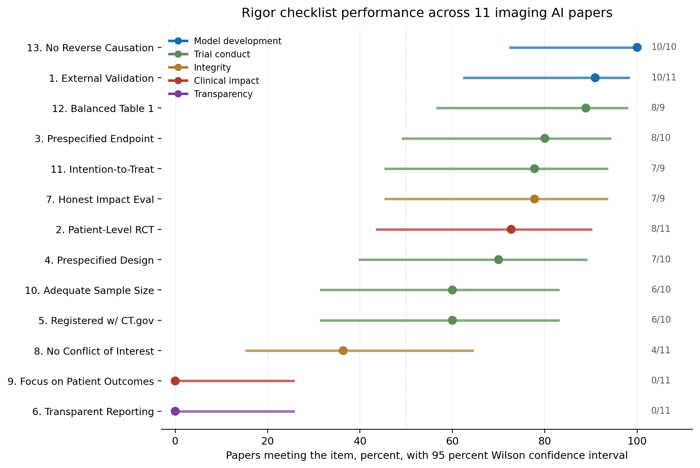

# Imaging Without Outcomes?

### A Targeted Rigor Appraisal of AI Based Imaging Prediction Tools in Medicine

A capstone research project. Published papers on imaging based artificial intelligence were read
in full and appraised against a thirteen item rigor checklist. Every verdict carries a written
justification. The whole appraisal is reproducible from the files in this repository.

**Scope.** The primary analysis set is **eleven imaging papers**, four retinal and seven
colonoscopy. Four electrocardiography papers form a **secondary set**, reported separately and
never pooled, because a twelve lead electrocardiogram is a time series rather than an image. One
further paper is the **reference case**, the trial to which this checklist was applied in its
original non imaging domain. The narrowing follows reviewer feedback and is logged as deviation
D7.

**Status.** Appraisal complete. Twenty papers handled in total, one hundred and ninety five
verdicts across the fifteen appraised, all scored and signed off. Statistical analysis complete
and scoped. No human second rater came forward, so the fallback specified in advance under deviation
D12 was executed on 3 August 2026, all three passes, and is reported as a reproducibility check
rather than as inter rater agreement. Every section of the paper is drafted, introduction through
conclusion, and assembled into a single manuscript at `Manuscript/Draft/manuscript.md`, built to
Word format with the forest plot embedded. Fourteen numbered tables and one figure.

---

## The question

Papers announcing medical AI tools tend to be evaluated on whether the model discriminates
well. That is a claim about the model. It is not a claim about the patient. This project asks
how far the published imaging AI literature travels from the first claim to the second.

**The hypothesis, stated before the appraisal began.** These papers will score well on the
items that ask whether the model works and poorly on the items that ask whether it helps
patients, and the distance between the two will be wider in imaging than in the domain where
the checklist was first applied.

The thirteen items come from the course Module 9 appraisal checklist, held at
`Refs/Lecture 9A Slides.pdf`. They appear as a table on slide 3, repeated unchanged on slide 31, and
all thirteen are reproduced here in the same order with none added, dropped or reordered. The
attribution was unverified for part of this project and is now closed, with D9 raising the question
and D10 recording its resolution. One item had been narrowed by this project along the way. The
comparison against the source found it and it was reverted, which D10 also records.

Walker and colleagues 2023 in JAMA Network Open, the CLOT trial, is the trial to which the
checklist was applied in its original non imaging domain. It is **not** the source of the item
wording. Its original use outside imaging is what makes the comparison possible, and it is scored
here as the reference case.

---

## What was found

The hypothesis holds, and it holds more sharply than it was stated.



Primary set, eleven imaging papers.

| Item group | Items | Rate | 95% CI |
| --- | --- | --- | --- |
| Model development, does the model work | 1, 13 | 95.2% | 77.3 to 99.2 |
| Integrity, honest reporting and independence from the maker | 7, 8 | 55.0% | 31.6 to 77.3 |
| Trial conduct, was the study run properly | 3, 4, 5, 10, 11, 12 | 72.4% | 54.0 to 89.6 |
| Clinical impact, does it help patients | 2, 9 | 36.4% | 19.7 to 57.0 |
| Patient outcomes considered alone | 9 | 0.0% | 0.0 to 25.9 |
| Transparency, is the model inspectable | 6 | 0.0% | 0.0 to 25.9 |

**The narrowest comparison is the sharpest one.** External validation was satisfied by ten of the
eleven papers. A genuine patient outcome was the primary endpoint in none of them. Because both
items are measured on the same eleven papers the comparison is paired, and ten papers fall on one
side of it with none falling on the other.

| | |
| --- | --- |
| Difference | 90.9 percentage points, 95% CI 52.3 to 98.4 |
| Test | exact McNemar, p = 0.0020, on 10 discordant papers |

At the group level, ten of eleven papers score strictly higher on model development than on
clinical impact, none score lower, and one ties. Sign test p = 0.0020.

Two columns contain no positive verdict at all. Transparency and patient outcomes are both zero
of eleven, with intervals running from 0.0 to 25.9, so neither excludes a true rate approaching
one paper in four. The conclusion survives at either end.

### A refinement the evidence forced

The original framing treated model development as the part that would score well. The data
complicates that. Transparency is also a model development property, and it is one of the two
worst performing columns in the appraisal. Not one paper in the primary set satisfied it.

So there are two failures rather than one, and they sit at opposite ends of the pipeline. These
papers reliably establish that the model **works**. They largely follow correct trial procedure.
They never establish that the model is **inspectable**, and they never establish that it **helps
patients**.

### Two findings that were not hypothesised

**Where these systems help, they help find the lesions that matter least.** Repici and colleagues
found the entire gain sat in adenomas below ten millimetres with advanced adenoma detection flat.
Alali and colleagues found the gain concentrated in diminutive hyperplastic polyps. Wei and
colleagues found more resections without more adenomas. Hsu and colleagues found the same and
also quantified the cost, since computer aided detection nearly doubled the proportion of
patients assigned to intensive surveillance. The checklist does not capture this pattern.

**Most of these trials were powered on baselines that reality contradicted.** Eight of the eleven
primary set papers were randomised trials. Six of those eight built a power calculation on a
baseline event rate the observed data went on to contradict, which is 75.0 percent with a 95
percent confidence interval of 40.9 to 92.9. The reference case makes the same error in milder
form, so the problem is not specific to imaging.

---

## The instrument

Thirteen items, each scored `Yes`, `No`, `Unclear` or `N/A`. The full wording of every item
lives in the `Legend` sheet of the tracker workbook.

| # | Short label | Asks |
| --- | --- | --- |
| 1 | External Validation | Does the model hold up on a separate dataset |
| 2 | Patient-Level RCT | Was impact tested in a pragmatic patient level randomised trial |
| 3 | Prespecified Endpoint | Was the primary endpoint fixed before the trial began |
| 4 | Prespecified Design | Was the design fixed before the trial began |
| 5 | Registered w/ CT.gov | Was the trial registered on ClinicalTrials.gov before initiation |
| 6 | Transparent Reporting | Are the predictors and their importance reported |
| 7 | Honest Impact Eval | Is the real world impact reported without overstatement |
| 8 | No Conflict of Interest | Is the study clear of any conflict of interest |
| 9 | Focus on Patient Outcomes | Is the endpoint a genuine patient outcome rather than a surrogate |
| 10 | Adequate Sample Size | Is the sample large enough to detect the claimed effect |
| 11 | Intention-to-Treat | Does the primary analysis follow intention to treat |
| 12 | Balanced Table 1 | Are the arms shown to be comparable |
| 13 | No Reverse Causation | Does the model avoid data leakage or an outcome used as a predictor |

### The item class rule

The single most consequential methodological decision in the project. It was adopted at paper
three and applied to every paper scored since.

Marking an item `N/A` because a paper's design does not reach it sounds fair, but for items 2
and 9 it destroys the hypothesis. If only papers that ran an impact trial are scored on whether
they ran an impact trial, the denominator collapses to exactly the papers that pass, and the
effect being measured disappears. So items are sorted into four classes by what may excuse them.

| Class | Items | N/A permitted when |
| --- | --- | --- |
| A | 2, 9 | Never. These are the dependent variables of the hypothesis |
| B | 3, 4, 5, 11, 12 | The paper has no trial arms |
| C | 7 | The paper contains no impact evaluation at all |
| D | 1, 6, 8, 10, 13 | Never. Scored for every paper regardless of design |

`N/A` is excluded from both numerator and denominator, so it never counts against a paper.

### Unclear conventions

`Unclear` is a verdict in its own right, not a gap. Items 3 and 4 score Unclear when a trial is
unregistered, because self reported prespecification cannot be checked against anything. Item 5
scores Unclear when a trial was registered prospectively but outside ClinicalTrials.gov, which
is not the same thing as reporting no registration at all.

---

## The corpus

Published between 2018 and 2026 and conducted across nine countries.

**Primary set, eleven imaging papers. Every headline figure above describes these.**

| Domain | n | Papers |
| --- | --- | --- |
| Retinal | 4 | Zhou 2023 (RETFound), Wolf 2024 (ACCESS), Abramoff 2018 (IDx-DR), Mathenge 2022 (RAIDERS, Rwanda) |
| Colonoscopy | 7 | Kader 2025 (EAGLE/CADDIE), Ahmad 2023 (AI-DETECT), Wei 2023 (AI-SEE), Repici 2020, Ladabaum 2023, Alali 2025 (Kuwait), Hsu 2026 |

**Secondary set, four electrocardiography papers**, reported separately and never pooled into a
headline figure. Lin 2024 (mortality), Yao 2021 (Mayo EAGLE), Tsai 2025 (Taiwan inpatient), Liu
2025 (CARDIOLOGIST).

The secondary set is retained rather than discarded because it carries two things the primary set
cannot supply. Lin 2024 is the only paper anywhere in the collection whose primary endpoint was a
genuine patient outcome, and it serves as the illustrative positive case. Liu 2025 reported
process measures as primary endpoints and patient outcomes as secondary ones, and found that two
process measures improved while not one patient outcome moved. That is the argument of this
capstone inside a single trial.

**Reference case, one paper.** Walker 2023, the CLOT trial, in `Papers/Reference/`. Scored on the
same thirteen items on its own sheet, excluded from every summary and export. It scores twelve of
thirteen, higher than any paper in the imaging set, and passes all three items the primary set
fails. n = 1, so it anchors the hypothesis's second clause rather than testing it.

**Five supporting papers** sit in `Papers/Supporting/`, documented but deliberately not scored,
each with the exclusion criterion that put them there. Keeping them visible rather than deleting
them is the point.

**Per paper scores in the primary set range from 33.3 percent to 84.6 percent.** The lowest is
Ladabaum 2023 at four of twelve and the highest is Hsu 2026 at eleven of thirteen. Lin 2024 in the
secondary set matches Hsu at eleven of thirteen. The Walker reference case scores twelve of
thirteen, higher than any appraised paper. Denominators differ because papers without trial arms
carry `N/A` under the item class rule.

---

## How the papers were chosen

The appraisal penalises papers for unverifiable prespecification, so the search that produced
the corpus was itself prespecified. The protocol was frozen on 28 July 2026, before any
expansion search ran and before any candidate was viewed. It lives in the `Search Protocol`
sheet.

**Selection rule.** Where eligible candidates exceeded a domain quota, they were selected in
descending order of publication date. Recency was chosen because it is outcome neutral. Ranking
by citation count would bias toward positive and widely promoted trials, and ranking by sample
size would bias toward industry funded ones.

**Page one verification, and why it exists.** Two of the original twelve slots, seventeen
percent, contained a PDF that was not the paper the manifest claimed. One held a pooled analysis
in place of a trial, the other a survey companion in place of its parent study. Both would have
been caught by opening the file and reading the first page. That check is now a mandatory step,
and on the first pass of eight new downloads it rejected two more.

**Everything assessed is logged.** The `Screening Log` sheet carries eighteen records with an
include or exclude decision and a reason, whether or not the paper entered the set. Papers that
weaken the hypothesis are reported rather than dropped.

**Deviations are logged too.** Sixteen of them, D1 through D16, with dates and rationale. The target
was revised downward from eighteen papers to fifteen because the retinal domain does not contain
six eligible completed impact trials. That scarcity is reported as a finding, not concealed as a
search failure. D7 records the scope narrowing and its cost. D8 records why the reliability sample
was not redrawn afterwards. D9 records that the checklist provenance was unverified and D10 records
how it was resolved, including one item wording this project had altered and has since reverted.
D11 freezes the instrument. D12 prespecifies what happens to the reliability assessment if no
independent human rater becomes available. D13 amends the transcription rule inside it, and records
that the amendment was made after the first session had been read. D14 records the execution of that
fallback and D15 the measurement of its stability across three passes. D16 records a data handling
error in which the transcription step wrote the completed model rating into the blank rater packet,
found on 4 August 2026 by a check rather than by a failure, with no rater ever receiving it and the
agreement figure verified to reproduce unchanged afterwards. Two deviations, D6 and D8, were
recorded late on audit rather than at the time, and both say so.

**One paper at a time.** Every verdict was proposed with reasoning and confirmed before any cell
was written. No batch scoring.

---

## Repository layout

```
Data/
  Tracker/
    checklist_scoring_tracker.xlsx    the authoritative record, seven sheets
    auto_review.xlsx / .csv           extracted evidence, 195 rows, no verdicts
    verification_log.csv              page one check for each of the 15 appraised PDFs
    exports/
      scoring_wide.csv                15 rows, one per paper, with a set column
      scoring_long.csv                195 rows, tidy, one per verdict, with a set column
      summary_by_item.csv             per item rates and diagnostics
      summary_by_group.csv            group rates, overall and per set
      ci_by_item.csv                  Wilson and Clopper-Pearson intervals
      ci_by_group.csv                 group rates, both interval methods
      ci_by_domain.csv                domain cells with intervals
      ci_contrasts.csv                the two prespecified contrasts
      ci_*_secondary.csv              the same, for the ECG secondary set
Notebooks/
  score_papers.ipynb                  evidence extraction from the PDFs
  refresh_tracker.ipynb               rebuilds the Summary tab and exports
  confidence_intervals.ipynb          interval estimation and the figure
  rater_agreement.ipynb               kappa and friends, run when ratings return
  build_manuscript.ipynb              manuscript.md to manuscript.docx, run after any edit
Papers/
  Retinal/ Colonoscopy/               the 11 primary set papers
  ECG/                                the 4 secondary set papers
  Reference/                          Walker 2023, the reference case
  Supporting/                         5 documented but unscored papers
Handover/                             the blinded second rater packet, send this folder
  RATER_INSTRUCTIONS.md               rules, with every verdict and count removed
  DEFINITIONS.md                      the four tier taxonomy for item 9
  scoring_form.xlsx                   blank, 65 rows, dropdown validated
  Papers/                             the 5 sampled PDFs
Drafts/
  hypothesis_assessment.md            written assessment against the hypothesis
  operational_definitions.md          patient outcome, surrogate, clinical impact
  second_rater_protocol.md            INTERNAL design record, do not send to the rater
  fallback_rater_protocol.md          INTERNAL, prespecified fallback if no human rater
  figures/                            forest plots, primary and secondary
Manuscript/Draft/
  manuscript.md                      THE FULL DELIVERABLE and single source of truth, edit this
  manuscript.docx                    built from it by build_manuscript.ipynb, never edited directly
  introduction.md  methods.md        superseded first drafts, kept for provenance only
  results.md  discussion.md          do NOT reassemble from these, they are behind manuscript.md
Manuscript/Submission/               the conference submission, a separate compressed paper
  main.tex                           NeurIPS 2026 workshop paper for Overleaf, 7 content pages
  Final Paper.pdf                    compiled from main.tex, package part one
  summary_sheet.md                   the capstone summary sheet source
  Summary Sheet.docx  .pdf           built from it by build_manuscript.ipynb, package part two
  Supplementary Materials.zip        package part three, the project stripped of copyrighted PDFs
  figures/                           the forest plot, copied for the Overleaf project
Refs/                                 Lecture 9A slides, the source instrument
Src/  Manuscript/Proposal/            reserved, not yet populated
Data/Search Results/                  reserved, raw search output not yet archived
requirements.txt                      pinned to the versions actually used
```

### The tracker workbook

| Sheet | Holds |
| --- | --- |
| `Legend` | Full wording of the thirteen items, the item class rule, the Unclear conventions |
| `Papers` | Manifest of fifteen appraised papers, five supporting and one reference case, with filenames and sources |
| `Scoring` | The record itself. Fifteen rows, thirteen verdict columns, a Yes count and a justification note running 1,180 to 3,844 characters |
| `Reference Case` | Walker 2023 scored on the same thirteen items. Excluded from every summary and export, and that exclusion is verified by re running the refresh notebook |
| `Summary` | Per item rates, item group rates split by set, per paper scores, column diagnostics |
| `Search Protocol` | The frozen protocol, inclusion and exclusion criteria, scoring rules, deviations log |
| `Screening Log` | Eighteen assessed records with decisions and reasons |

---

## The programmatic side

Seven notebooks. Everything is a notebook by design, and there are no standalone scripts.

### Run order

```
score_papers.ipynb          only when a PDF is added, replaced, or a pattern changes
        |
        v
   (human reads the paper and assigns every verdict by hand)
        |
        v
refresh_tracker.ipynb       after ANY change to the Scoring tab
        |
        v
confidence_intervals.ipynb  reads scoring_long.csv, so always run it after the above
        |
        v
rater_agreement.ipynb       only once, when the second rater returns the form

build_manuscript.ipynb      after ANY edit to manuscript.md, independent of the chain above
```

Running these out of order gives intervals computed on stale data with no error to warn you.

### `score_papers.ipynb`

Twelve cells. Opens each PDF, searches for regex patterns tied to each checklist item, and
records where the language appears with a page reference and a snippet.

**It does not assign verdicts, and this is deliberate.** The notebook originally offered two
auto suggest columns. The intention to treat suggestion was checked against five papers and was
wrong in five of five, by four distinct mechanisms. A line break split the phrase across two
lines. The principle was followed but never named. A different term was used, such as intent to
screen. The item was genuinely not applicable. Both suggestion columns were withdrawn and the
notebook now produces evidence only.

Three extraction failures were found and fixed along the way, and the fixes are worth knowing
about if you extend it. Line breaks split hyphenated terms, so all text is whitespace normalised
and the token separator is permissive. Some PDFs extract with spaces stripped entirely. Two
column journal layouts interleave the columns into nonsense, so each page is also cropped into
left and right halves and searched three ways.

### `refresh_tracker.ipynb`

Nine cells. Rebuilds the Scoring Yes count column and the entire Summary tab, then regenerates
the four core CSV exports.

**Why this exists.** The Summary holds static values rather than live formulas. Writing formulas
with openpyxl stores the formula string but strips the cached result, so Excel renders every
percentage as zero until something forces a recalculation. Two attempts to fix this at the
formula level failed. Static values with a visible last refreshed timestamp is the approach that
works. The whole rebuild sits in one cell so it cannot be partially executed.

### `confidence_intervals.ipynb`

Nineteen cells. Reads `scoring_long.csv` and never touches the workbook. Writes the four `ci_`
exports and the forest plot.

**One constant controls the scope.** `SCOPE` defaults to `"PRIMARY"`, the eleven imaging papers.
Set it to `"SECONDARY"` or `"ALL"` to re run everything on another set. Non primary outputs are
written with a filename suffix so they cannot overwrite the headline files.

Method choices, and why each one rather than the obvious alternative.

| Purpose | Method | Why not the default |
| --- | --- | --- |
| A single proportion | Wilson score | Four items sit at or near a boundary, where the normal approximation is useless |
| A single proportion, checked | Clopper-Pearson | Exact and conservative, carried alongside so boundary cells can be read either way |
| Difference between two items | Newcombe method 10 | The proportions come from the same papers, so they are paired |
| Testing that difference | Exact McNemar | Uses only the discordant pairs and is exact at small counts |
| A rate pooled over several items | Cluster bootstrap by paper | Pooled rates take several cells per paper, so the cells are not independent |

**One caution worth reading before quoting a group rate.** The cluster bootstrap turned out
narrower than the naive interval for four of the six groups, and on transparency it collapsed to
zero width, because every resample of an all zero column returns zero. That is an artifact of
having only fifteen clusters, not precision. The notebook therefore applies a rule fixed in
advance rather than choosing per number, and exposes the outcome in a `quote_method` column. Use
`quote_lo` and `quote_hi`. Do not pick between the candidate intervals by hand.

**A trap for anyone reading the exports.** `scoring_long.csv` contains the literal string `N/A`,
which pandas parses as a missing value by default and silently changes every denominator. Read it
with `keep_default_na=False`. The same trap applies to `pd.read_excel` on the handover form, where
it silently converted eleven legitimate `N/A` verdicts into unscored blanks before it was caught.

### `rater_agreement.ipynb`

Sixteen cells. Compares the second rater's independent verdicts against the first rater's. Reports
Cohen's kappa, raw percent agreement, PABAK and Gwet's AC1 together, because no single coefficient
is trustworthy on data this skewed toward `Yes`. Also gives a per item breakdown, `N/A`
concordance, a confidence cross tab, and a disagreement log with blank reconciliation columns.

Two rules are fixed in the notebook itself. Agreement is computed on the independent ratings
before any discussion, and it is never recomputed after reconciliation. Run it once and keep the
output.

It degrades cleanly while the form is still blank, and its statistics have been dry run against
synthetic data so the path is known to work before any real ratings arrive.

### `build_manuscript.ipynb`

Eight cells. Converts `manuscript.md` into `manuscript.docx` with the forest plot embedded, and
`Manuscript/Submission/summary_sheet.md` into `summary_sheet.docx` using the same parser and
renderer, so the two documents cannot drift apart in styling. Added on 8 August 2026.

**Why it exists.** Until that date the Word file was produced by some path outside this repository
and nothing here could rebuild it, which made the final deliverable the one artefact in the project
that was not reproducible. In a study about reproducibility that was the wrong thing to leave
undocumented.

It handles exactly the markdown the manuscript uses and nothing else. Headings at three levels,
paragraphs wrapped across lines, pipe tables, horizontal rules, one block quotation, one figure,
and inline bold and inline code. Ordered lists are deliberately not implemented, because several
wrapped lines in the reference list begin with a year and a full stop and a list parser would eat
them silently.

**The audit cells are the point.** They read each built document back and fail loudly if the
heading, table or figure count does not match the source, if any source line went unconsumed, if
unrendered markdown survived into the body, if the author placeholder is still present, or if table
and figure caption numbering is not a clean sequence. For the summary sheet they additionally check
that every field the capstone brief requires is present by name, that the abstract sits inside the
required 100 to 250 word window, and that the abstract quoted there is identical to the one in
`main.tex`. That last check has already caught one real drift. A conversion that drops content
quietly is worse than one that stops.

---

## The conference formatted paper

The capstone package goes to the institution, not to NeurIPS. The conference is the target venue
whose author instructions the paper must follow and whose logistics the summary sheet must document.
Submitting to it is not required, and as of 8 August 2026 is not planned.

The package has three parts. A final paper in PDF and editable form, a one to two page summary sheet,
and optionally any data, code or tools. The full manuscript in `Manuscript/Draft/` and the compressed
conference formatted paper in `Manuscript/Submission/` are different documents built from the same
appraisal.

**Part three, supplementary materials.** `Manuscript/Submission/Supplementary Materials.zip` is the
whole project directory with three things taken out. The published PDFs of the papers under study are
copyrighted and are replaced by `Papers/MANIFEST.md`, which lists all twenty one of them with a
retrieval pointer and preserves the folder structure, both because restoring the files should
reproduce the directory as it was scored and because `refresh_tracker.ipynb` and `score_papers.ipynb`
find the project root by looking for a folder named `Papers`. A duplicate copy of five of those PDFs
under `Handover/Papers/` is dropped for the same reason, and `Refs/` is dropped as course teaching
material. That takes 120 MB down to 1.7 MB across 83 files. Everything else is present in full, and
the fifteen CSV files in `Data/Tracker/exports/` were confirmed to regenerate byte for byte from the
extracted archive alone. The archive is a build output rather than a source, so if the project changes
it should be regenerated rather than edited in place.

**Target venue.** The AI for Meta-Science workshop at NeurIPS 2026, deadline 29 August 2026 anywhere
on earth, notification 29 September 2026, hosted at the NeurIPS Paris site in December 2026. The
NeurIPS 2026 main track closed on 6 May 2026, so a workshop is the only route into this year's
conference. Full venue details are in `Manuscript/Submission/summary_sheet.md`.

**Build modes.** `main.tex` produces three outputs from one line. `[preprint]` is active and is the
capstone artefact, showing the author block with no review line numbers and a footnote that names
the target venue without claiming submission or acceptance. Removing the option gives the anonymised
double blind build for an actual submission. `[final,dblblindworkshop]` is camera ready and is only
appropriate after acceptance.

**Why this venue.** The workshop is convened around quality control in the scientific record and
around whether evaluation can be scaled to match the rate at which science is produced. That makes
the model reproducibility check a second contribution rather than a fallback, because measuring how
far an instrument survives an automated reader is exactly the workshop's question.

**What differs from the full manuscript.** The submission is eight pages plus an unlimited appendix,
so ten of the fourteen tables are relocated rather than cut. It is anonymised for review. The
instrument's provenance is reframed as standard clinical trial appraisal criteria rather than course
material, which is both required for anonymity and necessary for an external venue. It carries the
sixteen item NeurIPS paper checklist, which does not count against the page limit. It also states
plainly, as the full manuscript does and the compressed first draft did not, that the first rating
was itself model assisted under author sign off, which bounds what the agreement figure means and
is required by the NeurIPS policy on declaring LLM use in the core method.

**Measured against the venue.** The first build came to eleven pages, with the body ending a third
of the way down page seven, so seven content pages against a limit of eight. Anonymity, line
numbering and the required workshop footnote all render correctly.

**To build the PDF.** Download the official NeurIPS 2026 template zip, upload it to Overleaf,
replace its main file with `main.tex` and add the `figures/` folder. Build instructions and all
three build modes are documented in the header comment of `main.tex`.

---

## Reproducing this

```bash
pip install -r requirements.txt
```

Then open the notebooks in order and Run All. Close the workbook in Excel first, since openpyxl
cannot write to an open file. Python 3.13.14 was used throughout.

---

## Limitations

Stated plainly, because the project is about rigor.

**Three checklist items carry little or no information in this domain.** This is a finding about
whether the instrument transfers, not a defect in the scoring.

**Three of the thirteen items take a single value across the primary set.** Item 6 is zero of
eleven, item 9 is zero of eleven, item 13 is ten of ten. An item that never varies cannot
discriminate between papers.

Item 13, reverse causation, returned a single verdict across every paper in the study and is
formally degenerate. Authors do not report their own data leakage, so the question cannot be
answered from a published document.

Item 8, conflict of interest, was degenerate until 2 August 2026 and the cause turned out to be
this project rather than the instrument. It had been applied as "clear of undisclosed conflicts of
interest" when the Module 9 source reads "clear of any conflict of interest". Under the narrowed
wording it returned no negative verdict in sixteen papers, and that degeneracy was written up as
an instrument limitation. It was an artifact of the rewording. The wording was reverted, every
paper was rescored, and the item now returns four of eleven in the primary set. What it reveals is
that seven of the eleven papers were evaluated by people with a financial or ownership interest in
the tool under test, or were funded by its maker. See
[checklist_provenance.md](Drafts/checklist_provenance.md).

Item 2, patient level randomisation, penalises a defensible design choice. Cluster randomised
trials score No, yet for a tool that alerts a clinician rather than treating a patient, cluster
allocation is arguably more rigorous because it removes contamination.

**Eleven papers is a small sample.** No item rate is pinned down to better than twenty six
percentage points, and the median interval width across the thirteen items is forty five. The
direction of the effect is established beyond reasonable doubt because the comparison is paired and
every paper that differs falls the same way. The magnitude is not.

**Only one database was searched.** Embase and Web of Science are named in the protocol as
secondary sources and were never run. This is the principal reason the study is presented as a
targeted appraisal rather than as a systematic review.

**The protocol was frozen after ten of the papers were already scored**, so those ten were not
selected under it.

**Domain rates cannot be compared.** Mean interval width across the twenty six primary set domain
cells is fifty four percentage points and the narrowest is thirty five. The domain comparison is
withdrawn as an aim of the study and reported instead as a demonstrated negative result.

**Three of the four ECG papers come from one research group** at a single institution in Taipei
with heavily overlapping authorship. Any claim that this domain behaves differently may partly
reflect the behaviour of that group. Logged as deviation D4.

**Verdicts were assigned by a single appraiser.** The appraiser worked with the assistance of a
large language model, which proposed each verdict with written reasoning for review and sign off
before anything was written to the record. A second independent rater with a measure of agreement
would strengthen the design considerably and remains the obvious next step. A fallback is
specified in advance under deviation D12 for the case where no independent human rater becomes
available.

**The reference case is co authored by one of the course instructors.** Daniel W. Byrne is the
eighth author on Walker and colleagues 2023, the CLOT trial, which serves as this study's reference
case and is the highest scoring document anywhere in the collection at twelve of thirteen. The
instrument derives from the same course. Neither instructor took any part in scoring that paper and
neither was consulted on any verdict. Every verdict was proposed with written reasoning and signed
off by the appraiser alone, and the reference case sits on its own sheet excluded from every summary
and export. It is a single trial, so it anchors the hypothesis's second clause rather than testing
it, and no quantitative claim rests on it. Disclosed because this appraisal scores eleven other
papers on undisclosed proximity between the evaluator and the evaluated. Recorded in the limitations
of both the manuscript and the conference paper.

---

## What is left

1. **Fill in the author block placeholders** in `main.tex`, which carries `[Institution]` and
   `[email address]` rather than guesses, then recompile. The last build came to fifteen pages with
   the body ending 54 percent down page seven, so seven content pages against the venue's limit of
   eight, with references, appendix and checklist all excluded from that count. Verifying the
   checklist question wording against the template zip's own checklist file is worth ten minutes,
   since that wording was taken from the NeurIPS public guide rather than the template.
2. **A human second rater, closed as unavailable.** No person came forward and none is expected, so
   this is recorded as a limitation of the study rather than as outstanding work. The protocol is
   written and fixed in advance in
   [second_rater_protocol.md](Drafts/second_rater_protocol.md), and the handover packet remains
   built and verified blank, so the option stays open if circumstances change. The fallback in
   [fallback_rater_protocol.md](Drafts/fallback_rater_protocol.md) was executed instead and
   returned a Cohen's kappa of 0.686 with 83.0 percent raw agreement, logged as D14. That is
   reported as a reproducibility check on the instrument and is not presented as satisfying the
   reviewer request. All three specified passes were run, giving a Fleiss' kappa of 0.844 for the
   rater against itself, logged as D15. If a person does come forward the human result becomes
   primary automatically, which was fixed in advance so the choice could not be made after seeing
   any of these numbers.
3. **Four citations need a volume and page lookup.** Ladabaum, Wolf, Abramoff and Kader do not
   print those details on page one of the stored PDF, so those four entries carry a digital object
   identifier instead. The other eleven were verified against page one on 8 August 2026, and four
   titles recorded as paraphrases during the appraisal were replaced with the published wording at
   the same time. One of those corrections moved the Kader EAGLE paper from 2026 to 2025, which is
   now consistent across the manuscript, the README and the tracker.
4. **Two papers worth chasing.** PubMed 42365851, the rank one colonoscopy candidate that was
   never obtained and is logged as deviation D6, and a results publication for the Tanzania
   retinal trial, which is currently a protocol paper only.

---

## Source

Checklist adapted from Walker et al. 2023, JAMA Network Open, on the CLOT trial, together with
the course Module 9 appraisal checklist. Every appraised paper is cited in full in the `Papers`
sheet of the tracker workbook.

---

## About this public copy

This repository holds the analysis, data, protocols, and manuscript. A few inputs are not included. The appraised papers are publishers' copyrighted PDFs, so `Papers/` and `Handover/Papers/` are omitted, and each paper is identified by its citation in the manuscript instead. The course lecture slides in `Refs/`, which hold the original checklist, are also omitted, along with private course feedback. Every verdict, justification, and statistic can still be checked against the files here. `score_papers.ipynb` needs the PDFs placed in `Papers/` to rerun the evidence extraction.

Completed for EN.705.617 Artificial Intelligence in Healthcare at Johns Hopkins University (Summer 2026).
